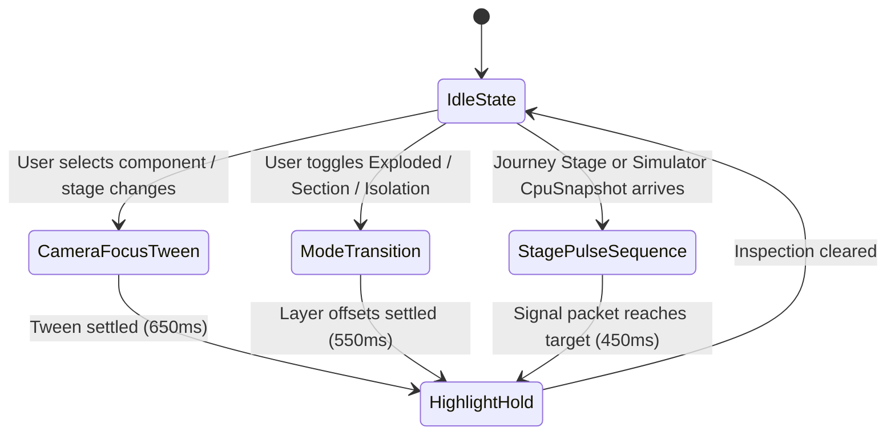

# Animation System Specification — TIANEDGE

**Document ID:** `TIANEDGE-ANIM-001`  
**Product Name:** TIANEDGE — Semiconductor & Microprocessor Exploration Platform  
**Scope:** Category A (Idle Animations) & Category B (Guided State-Driven Animations)  

---

## 1. Purpose and Design Philosophy

Animations in **TIANEDGE** serve engineering clarity, spatial comprehension, and optical craft. Every motion strictly obeys Constraints `C-07` and `C-08`:

- **Idle animations** bring the laboratory stage alive subtly without distracting from technical reading or wasting GPU power.
- **Guided animations** must be **strictly derived from real application state** (selected `componentId`, active visualization mode, `Instruction Journey` stage, or `CPU Simulator` `CpuSnapshot`). Arbitrary disconnected eye-candy motion is prohibited.

---

## 2. Category A — Idle Animation System

Idle animations run automatically on the `Overview` (`/`) hero stage and gently during inactive periods on `Chip Anatomy` (`/anatomy`) when no guided transition or user drag is active.

### 2.1 Idle Effects Catalog

| Effect ID | Target Elements | Visual Behavior | Parameters & Constraints |
|---|---|---|---|
| `idle_hero_orbit` | Full CPU assembly group (on `/` Overview only) | Smooth slow sinusoidal yaw drift or continuous slow orbit (`0.04 rad/s`). | Immediately yields when user drags camera; auto-resumes after `4,000 ms` inactivity on Overview only (disabled during `Chip Anatomy` inspection so user orientation stays locked). |
| `idle_core_activity` | `die-cpu-cores` tiles | Gentle asynchronous breathing emissive pulse across Core 0–3 tiles (`opacity/emissive: 0.15 -> 0.40`). | Period `3.6 s` staggered phase `0.9 s` per core; suppressed when user selects a specific component or runs simulator. |
| `idle_signal_shimmer` | `comm-interconnect-network` & `comm-internal-buses` | Soft low-intensity (`0.25`) cyan wave traveling along ring/mesh fabric lines. | Runs at subtle ambient speed; overridden immediately in `Signal Flow` or `CPU Simulator` by deterministic stage pulses. |
| `idle_cooling_airflow` | Translucent streamlines above `pkg-ihs` (`Overview` / `Full Assembly`) | Ultra-subtle pale-cyan/slate thermal convection arcs rising gently off the IHS surface (`8–12` instanced ribbon segments). | Toggleable via scene overlay switch; conveys thermal dissipation purpose of `pkg-ihs` without fogging die visibility. |
| `idle_illumination_sweep` | `pkg-silicon-die` rim & `pkg-electrical-contacts` | Restrained specular sweep highlighting physical metallic contrast. | Driven by subtle light rotation (`<= 0.015 rad/s`), zero extra draw calls. |

### 2.2 Idle Pause, Power & Reduced-Motion Rules

1. **Tab Visibility:** Subscribes to `document.visibilitychange`; suspends `requestAnimationFrame` delta progression when tab is hidden (`0%` background GPU draw).
2. **Interaction Yield:** Any `OrbitControls` `onStart` pointer drag or component selection pauses `idle_hero_orbit` immediately.
3. **Reduced-Motion Compliance (`prefers-reduced-motion: reduce` or UI Toggle):**
   - Disables `idle_hero_orbit`, `idle_cooling_airflow`, `idle_signal_shimmer`, and `idle_core_activity` oscillations.
   - Replaces animations with crisp static high-contrast illumination markers.

---

## 3. Category B — Guided Animation System

Guided animations translate educational state transitions and live CPU execution into readable spatial choreography.

### 3.1 Guided Animation Triggers & State Coupling



### 3.2 Guided Behaviors Specification

| Behavior ID | Trigger Source | Choreographed 3D Sequence | Timing & Easing |
|---|---|---|---|
| `guided_camera_focus` | Click mesh / Tree select / Insights `"Inspect in 3D"` / Journey stage change (when Auto-Focus enabled) | Smoothly interpolates `camera.position` and `controls.target` to component's `cameraPreset` coordinates. Cancels immediately if user touches mouse/touch controls. | `650 ms`, `cubicOut` (`1 - (1-t)^3`). Instant snap (`0 ms`) under Reduced Motion. |
| `guided_exploded_layers` | Switch visualization mode to `exploded_view` vs. `full_assembly` | Interpolates `pkg-ihs` (`+1.40`), `pkg-silicon-die` (`+0.55`), `pkg-solder-bumps` (`+0.18`), `pkg-substrate` (`0.00`), `pkg-electrical-contacts` (`-0.22`) smoothly along `Y`. | `550 ms`, `cubicInOut`. |
| `guided_section_cut` | Switch mode to `section_cut` or drag Slice Slider (`-2.0` to `+2.0`) | Smoothly sweeps WebGL `Plane(new Vector3(-1, 0, 0), offset)` across IHS/substrate layers to reveal internal silicon die & C4 bump cross-section. | `450 ms` entry sweep; `0 ms` direct drag response. |
| `guided_component_isolation` | Switch mode to `component_isolation` | Dims non-selected meshes (`opacity: 0.08`, `depthWrite: false`) and boosts selected component emissive halo (`#00E5FF`). For Group E (`digital-logic`), smoothly switches stage to enlarged conceptual model pod. | `350 ms` cross-fade. |
| `guided_component_highlight` | Hover, Select, or `CpuSnapshot.activeComponentIds` | Applies cyan (`#00E5FF`) selection outline/emissive for primary active units and warm gold (`#FBBF24`) pulse on `core-control-unit` / active register write targets. | `150 ms` fade-in; active hold while selected or stage active. |
| `guided_signal_packet_flow` | `Instruction Journey` stage OR `CPU Simulator` `CpuSnapshot.activePaths` | Spawns instanced luminous cyan/gold signal spheres traveling along quadratic/Catmull-Rom `comm-data-paths` spline edges from exact source `componentId` anchor to destination `componentId` anchor. | `450 ms` per packet traversal (auto-scales down smoothly if Simulator `executionSpeedMs < 500ms`; skipped under Reduced Motion, showing solid directional highlighted path instead). |

---

## 4. Canonical Stage-to-Animation Mapping (Journey & Simulator Unified)

Both `Instruction Journey` and `CPU Simulator` drive guided animations using the exact same canonical stage mapping:

| Stage | Highlighted Components (`componentId`) | Control Signal Accent (`#FBBF24`) | Animated Data Path Edges (`activePaths`) | Camera Framing Focus |
|---|---|---|---|---|
| `1. FETCH` | `core-registers` (`PC`), `mem-l1-icache`, `core-instruction-decoder` (`IR`) | `PCWrite`, `MemRead`, `IRWrite` | `pc_to_l1i`, `l1i_to_ir` | Wide front-end core framing (`mem-l1-icache` + `core-instruction-decoder`) |
| `2. DECODE` | `core-instruction-decoder`, `core-control-unit` | Opcode decode vector | `ir_to_decoder`, `decoder_to_cu` | Tight focus on `core-instruction-decoder` & `core-control-unit` |
| `3. REGISTER_READ` | `core-registers`, `mem-register-file` | `RegReadA`, `RegReadB` | `regs_to_alu_opA`, `regs_to_alu_opB` (if `ADD`/`SUB`/`STORE`) | Focus on `mem-register-file` -> `core-alu` operand bridge |
| `4. EXECUTE` | `core-alu`, `core-execution-units`, `core-control-unit` | `ALUOp` (`ADD`/`SUB`/etc.) | `alu_compute_internal` / `alu_to_flags` | Macro focus on `core-alu` & `FLAGS` indicator |
| `5. MEMORY_ACCESS` | `core-load-store-unit`, `mem-l1-dcache`, `comm-memory-interface`, `die-memory-controller` | `MemRead` or `MemWrite` *(dimmed if stage bypassed)* | `lsu_to_l1d`, `l1d_to_mem_if` (active on `LOAD [addr]`/`STORE`) | Shift framing toward `core-load-store-unit` & `comm-memory-interface` |
| `6. WRITE_BACK` | `core-registers`, `mem-register-file`, `comm-data-paths` | `RegWrite` *(dimmed if stage bypassed)* | `alu_to_wb_regs` or `mdr_to_wb_regs` | Pan smoothly back to destination register slot in `core-registers` |

---

## 5. TypeScript Animation Orchestrator Contract

```typescript
export interface GuidedAnimationCommand {
  mode: "full_assembly" | "exploded_view" | "section_cut" | "component_isolation" | "internal_architecture" | "signal_flow";
  focusedComponentId: string | null;
  highlightedComponentIds: string[];
  controlHighlightedIds: string[];
  activePathEdges: DataPathEdgeId[];
  packetDurationMs: number;
  reducedMotion: boolean;
}
```

### Synchronization Guarantees

- When the Simulator is in high-speed continuous `Run` (`executionSpeedMs < 150 ms`), packet animations automatically compress or switch to instantaneous highlighted bus lines so animation lag never causes visual phase drift behind the Rust/WASM `Program Counter`.
- When paused or stepped manually (`Step Stage`), full `450 ms` directional signal packet animations play cleanly once per step so every learner clearly observes operand movement.
