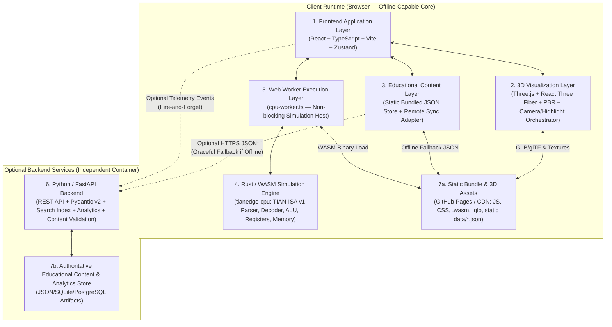
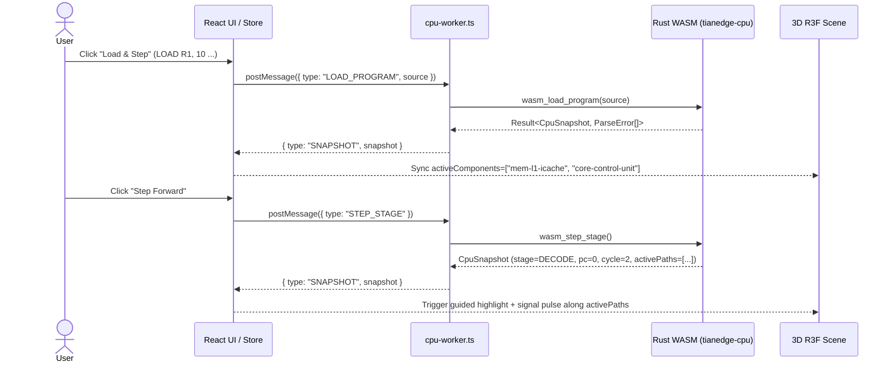
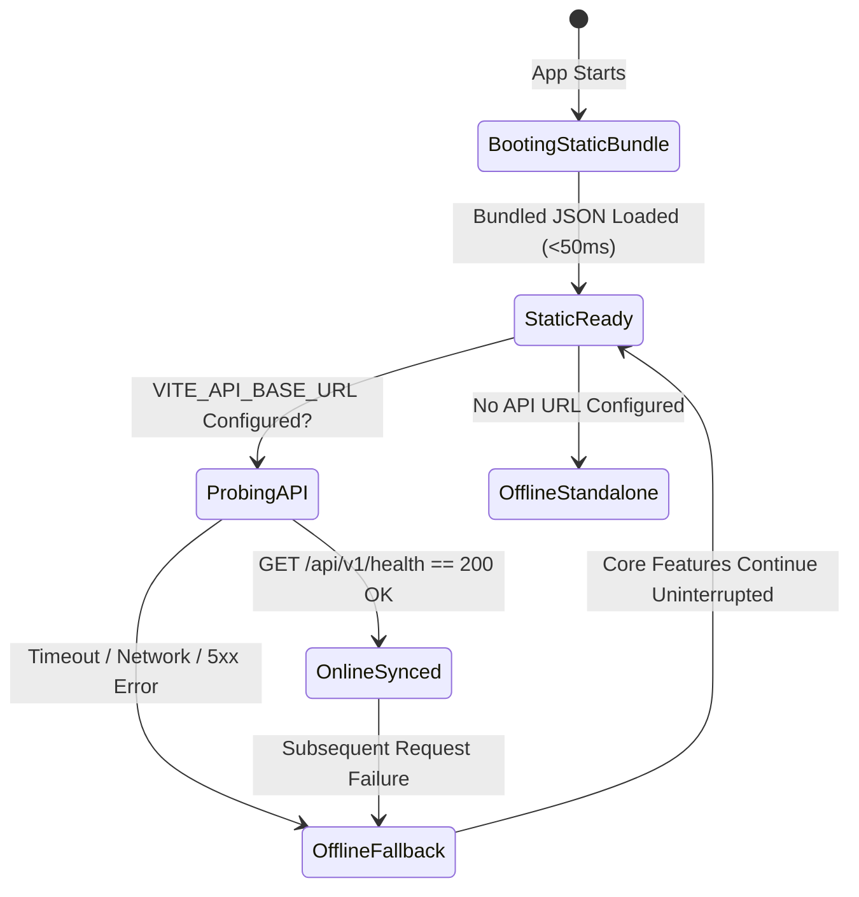

# Software & System Architecture — TIANEDGE

**Document ID:** `TIANEDGE-ARCH-001`  
**Product Name:** TIANEDGE — Semiconductor & Microprocessor Exploration Platform  
**Technology Core:** TypeScript (React + Three.js/R3F) + Rust (WASM + Web Worker) + Python (FastAPI)  

---

## 1. Purpose and Scope

This document defines the end-to-end software architecture, module boundaries, state ownership, runtime execution model, communication protocols, initialization lifecycle, and offline resilience strategy for **TIANEDGE**. Every layer is structured so that the **3D exploration experience** and the **CPU Instruction Execution Simulator** operate reliably in the browser without runtime dependency on the Python backend.

---

## 2. High-Level Layered Architecture

TIANEDGE follows a strict **7-layer modular architecture**:

---

## 3. Layer Responsibilities and Module Boundaries

### 3.1 Layer 1 — Frontend Application Layer (`apps/web/src/`)

- **Technology:** TypeScript (strict mode), React 18+, Vite, Zustand (domain-sliced state stores), lightweight routing (`react-router` or equivalent hash/browser router configured for base path).
- **Responsibilities:**
  - Route orchestration across the six canonical sections (`Overview`, `Chip Anatomy`, `Instruction Journey`, `CPU Simulator`, `Engineering Insights`, `Technical Library`).
  - UI layout, component inspection drawers, simulator control panels, assembly program editor, register/memory tables, and accessibility controls (`prefers-reduced-motion`, keyboard shortcuts).
  - Coordinating state transitions between user actions, the 3D Visualization Layer, and the Web Worker CPU Engine client.
- **Forbidden Responsibilities:** Must **never** re-implement instruction parsing, ALU arithmetic, register updates, or cycle stepping in TypeScript. All simulation authority resides in Rust/WASM.

### 3.2 Layer 2 — 3D Visualization Layer (`apps/web/src/scene/`)

- **Technology:** Three.js, React Three Fiber (`@react-three/fiber`), `@react-three/drei`, custom GLSL/shader or instanced signal-pulse helpers where needed.
- **Responsibilities:**
  - Loading and caching GLB/glTF processor assets and procedural conceptual logic models (`logic-transistors`, `logic-gates`, etc.).
  - Enforcing the six visualization modes (`Full Assembly`, `Exploded View`, `Section Cut`, `Component Isolation`, `Internal Architecture`, `Signal Flow`).
  - Raycasting for hover and click selection, emitting canonical `componentId` values to the UI/Anatomy store.
  - Executing idle animations and state-driven guided animations (camera tweening, component highlight emissive accents, signal packet interpolation along data paths).
- **Forbidden Responsibilities:** Must **never** embed technical prose inside 3D mesh code; all text/specifications come exclusively from the Educational Content Layer keyed by `componentId`.

### 3.3 Layer 3 — Educational Content Layer (`apps/web/src/content/`)

- **Technology:** TypeScript repository client + JSON schema validators + bundled static snapshot (`apps/web/public/data/*.json`).
- **Responsibilities:**
  - Resolving `ChipComponent` records (all 36 components), `EngineeringInsightTopic` articles (all 13 topics), `GlossaryTerm`, `FormulaEntry`, `TechnicalReference`, and `LearningPath` objects.
  - Managing the **Backend-Independent Hybrid Strategy**: attempts optional hydration/search queries against the FastAPI endpoint when `VITE_API_BASE_URL` is configured and healthy, and transparently falls back to bundled static JSON datasets with zero feature degradation when unavailable.

### 3.4 Layer 4 — Rust / WASM Simulation Engine (`crates/tianedge-cpu/`)

- **Technology:** Rust (2021 edition), `serde` / `serde_json`, `wasm-bindgen`, compiled to `wasm32-unknown-unknown`.
- **Responsibilities:**
  - Lexical scanning, parsing, syntax/operand validation, and label resolution for `TIAN-ISA v1` programs.
  - Deterministic 6-stage state machine (`FETCH` -> `DECODE` -> `REGISTER_READ` -> `EXECUTE` -> `MEMORY_ACCESS` -> `WRITE_BACK`).
  - Register file (`R0`–`R7`), special registers (`PC`, `IR`, `MAR`, `MDR`, `FLAGS`), ALU (`ADD`, `SUB`, `MUL`, `AND`, `OR`, `XOR`, `CMP`), Instruction Memory (`0..255`), Data Memory (`0..255` 32-bit signed integers), and clock-cycle counter.
  - Producing structured execution snapshots (`CpuSnapshot`) including active stage, active `componentId[]` list, active data-path edge IDs, and deterministic error diagnostics.
- **Forbidden Responsibilities:** Must have **zero** DOM/Three.js dependencies and **zero** network dependencies so it passes native `cargo test` headless as well as browser WASM execution.

### 3.5 Layer 5 — Web Worker Execution Layer (`apps/web/src/workers/cpu-worker.ts`)

- **Technology:** Web Worker API + typed TypeScript message RPC wrapper (`CpuWorkerClient`).
- **Responsibilities:**
  - Instantiating the `.wasm` module off the React/Three.js main UI thread.
  - Owning continuous `Run` timing loops (bounded by user-selected `executionSpeedMs`) so high-step programs or custom loops cannot block 60 FPS WebGL rendering.
  - Enforcing watchdog step limits (e.g., max 10,000 cycles per continuous run burst or explicit loop safeguard) to protect browser responsiveness against accidental infinite `JMP` programs.
  - Posting immutable `CpuSnapshot` deltas/frames back to the main thread for UI and 3D synchronization.

### 3.6 Layer 6 — Python / FastAPI Backend (`services/api/`)

- **Technology:** Python 3.11+, FastAPI, Pydantic v2, Uvicorn, pytest.
- **Responsibilities:**
  - Serving structured endpoints for health status, component metadata, engineering insights, technical library search/filtering, and optional anonymous educational analytics events.
  - Validating canonical educational content integrity at build/startup using Pydantic models derived from [DATA_MODEL.md](./DATA_MODEL.md).
- **Forbidden Responsibilities:** Must **never** own core CPU instruction execution, register state, or block the frontend from rendering or simulating.

### 3.7 Layer 7 — Asset and Content Delivery

- **Frontend & WASM Static Package:** Deployed as static artifacts (e.g., GitHub Pages or static CDN) containing compiled HTML/JS/CSS, `.wasm` binary, Draco/meshopt-optimized `.glb` assets, and static educational JSON snapshots.
- **Backend Container:** Independently deployable FastAPI Docker container exposing HTTPS REST APIs with explicit CORS allowlists.

---

## 4. State Ownership Matrix

To prevent split-brain state bugs between React UI, Three.js, and Rust/WASM, every domain has a single authoritative owner:

| State Domain | Authoritative Owner | Mirror / Read-Only Consumers |
|---|---|---|
| CPU Registers, Memory, PC, IR, Flags, Cycle Count, Execution Status | **Rust/WASM Engine** (inside Web Worker) | Frontend Simulator Store, 3D Signal/Highlight Mapper |
| Active Program Source & Assembly Editor Draft | **Frontend Simulator Store** (`useSimulatorStore`) | Sent to Rust/WASM on `LOAD_PROGRAM` command |
| Active Visualization Mode (`Full Assembly`, `Exploded View`, etc.) | **Frontend 3D Scene Store** (`useAnatomyStore`) | R3F Scene Components, Mode Toolbar |
| Selected / Hovered `componentId` & Visibility Filters | **Frontend 3D Scene Store** (`useAnatomyStore`) | Component Tree, Inspection Drawer, 3D Mesh Materials |
| Camera Pose, Target, Tween Queue, Reduced-Motion Flag | **3D Camera/Animation Controller** (in R3F) | Triggered via declarative commands from UI/Journey/Simulator |
| Instruction Journey Stage (`1..6`), Play/Pause, Active Walkthrough | **Frontend Journey Store** (`useJourneyStore`) | Journey Controls, 3D Guided Animation, Stage Explanation Panel |
| Component Metadata, Insights, Glossary, Formulas | **Educational Content Service** (Static JSON + API cache) | Anatomy Drawer, Insights View, Library View |
| Backend Availability & Sync Status | **API Health Monitor** (`useContentStore`) | Non-blocking Header/Settings Status Badge |

---

## 5. Communication Protocols

### 5.1 Main Thread <-> Web Worker <-> Rust/WASM Sequence

### 5.2 Worker Message Envelope

Every worker boundary call uses a discriminated union message with a monotonic `requestId`:

- **Inbound Commands (UI -> Worker):**
  - `INIT_WASM`: Initialize compiled WASM engine and verify ABI version (`1.0.0`).
  - `LOAD_PROGRAM`: Assemble and load `TIAN-ISA v1` source text, resetting registers/memory or applying optional initial overrides.
  - `STEP_STAGE`: Advance exactly one canonical stage (`FETCH`..`WRITE_BACK`) = 1 simulated clock cycle.
  - `STEP_INSTRUCTION`: Advance remaining stages to complete one full instruction.
  - `RUN`: Start non-blocking timer loop at `speedMs` interval until `HALTED`, error, `PAUSE`, or cycle safety cap.
  - `PAUSE`: Stop active continuous timer loop cleanly at the current stage boundary.
  - `RESET`: Restore initial program state (`PC=0`, registers zeroed or restored to preset initial state, `cycle=0`).
- **Outbound Events (Worker -> UI):**
  - `READY`: Engine initialized with ABI version & capability metadata.
  - `SNAPSHOT`: Full deterministic `CpuSnapshot` object.
  - `PARSE_ERROR`: Structured line/column/token diagnostic list when assembly fails validation.
  - `RUNTIME_ERROR`: Deterministic fault (e.g., out-of-bounds memory address, division/overflow policy, max-cycle guard reached).

### 5.3 Educational Content & Fallback Lifecycle

---

## 6. Initialization & Loading Lifecycle

1. **Shell Boot (0–150 ms):** React mounts dark graphite application shell (`#0B0F17`), navigation bar, and static content index.
2. **Parallel Background Initialization:**
   - **Stream A (Worker + WASM):** `CpuWorkerClient` spawns `cpu-worker.ts`, streams `tianedge_cpu_bg.wasm`, confirms `READY` state.
   - **Stream B (3D Assets):** `Overview` / `Chip Anatomy` mounts R3F `<Canvas>` with Suspense placeholder; loads base CPU Package GLB first, deferring heavy high-detail die/conceptual models via progressive asset loader.
   - **Stream C (Content Hydration):** Loads bundled `components.json` / `insights.json` / `library.json`; optionally pings `/api/v1/health` with a strict `1500 ms` timeout so slow networks never stall UI boot.
3. **Graceful Degradation Rules:**
   - If WebGL2 context creation fails or is lost, display a structured architectural fallback notice with 2D schematic SVG view and full access to component metadata, `CPU Simulator` tabular/register execution, `Engineering Insights`, and `Technical Library`.
   - If the FastAPI backend is down, display a subtle non-modal `"Local Mode"` indicator and route all content lookups to the bundled JSON store.

---

## 7. Performance & Security Boundaries

### 7.1 Performance Boundaries

- **Main-Thread Protection:** Continuous simulator execution loops live strictly inside `cpu-worker.ts`; React state updates throttle high-speed continuous UI snapshots to at most 30 Hz when `executionSpeedMs < 33ms`, while retaining full fidelity for single-step mode.
- **3D Rendering Budget:** Shared PBR materials, instanced solder bumps/electrical contacts, compressed GLB textures (`<= 1024x1024` or procedural normal/roughness maps), and `frameloop="always"` paused automatically when tab is hidden (`document.hidden`) or `prefers-reduced-motion` is active without active interaction.

### 7.2 Security & Safety Boundaries

- **Untrusted User Assembly Input:** Treated strictly as sandboxed `TIAN-ISA v1` text parsed by safe Rust slices (no `unsafe` Rust blocks, no `eval`, bounded memory array `0..255`, bounded continuous cycle guard).
- **Content Rendering:** All educational markdown/rich text rendered safely without raw HTML injection (`dangerouslySetInnerHTML` forbidden unless sanitized).
- **CORS & Privacy:** Optional FastAPI analytics records only anonymized aggregate interaction events (e.g., component IDs viewed, journey completion counts) — zero PII, zero arbitrary code storage.

---

## 8. Cross-Document References

- Product Requirements: [PRD.md](./PRD.md)
- Engineering Constraints: [constraints.md](./constraints.md)
- Canonical Data Structures: [DATA_MODEL.md](./DATA_MODEL.md)
- Backend API Contract: [API_CONTRACT.md](./API_CONTRACT.md)
- Primary Simulator Details: [SIMULATION_SPEC.md](./SIMULATION_SPEC.md)
- 3D Asset Guidelines: [ASSET_GUIDELINES.md](./ASSET_GUIDELINES.md)
- Deployment Specification: [DEPLOYMENT.md](./DEPLOYMENT.md)
