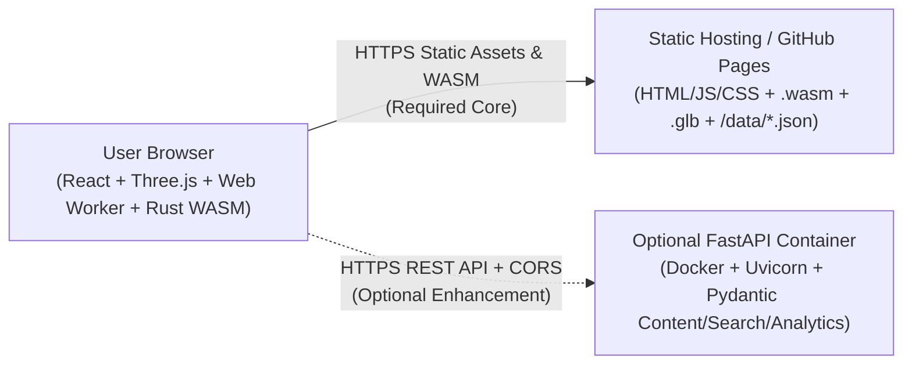

# Deployment Architecture & Delivery Specification — TIANEDGE

**Document ID:** `TIANEDGE-DEP-001`  
**Product Name:** TIANEDGE — Semiconductor & Microprocessor Exploration Platform  
**Status:** Live — static frontend deployed to GitHub Pages at https://orls967.github.io/TianEdge/ by [`.github/workflows/deploy.yml`](./.github/workflows/deploy.yml) on every push to `main`. The FastAPI container is optional and not hosted.  

---

## 1. Deployment Topology Overview

TIANEDGE uses a **decoupled static-first delivery topology**:

1. **Frontend + WASM + 3D Assets + Static Content Bundle:** Built as static files via Vite (`apps/web/dist/`) and deployed to **GitHub Pages** (or any static CDN such as Cloudflare Pages / Netlify).
2. **Optional Python FastAPI Backend (`services/api/`):** Independently containerized via Docker and hosted on a container platform (e.g., Fly.io, Railway, Cloud Run, or self-hosted VPS behind TLS) strictly for live content API, search, and anonymous analytics.

Because core exploration and the Rust/WASM simulator execute locally in the browser (`C-04`), the GitHub Pages static deployment functions **100% standalone** even if the Python container is scaled to zero or not yet provisioned.



---

## 2. Build Pipelines

### 2.1 Rust -> WebAssembly Build (`crates/tianedge-cpu`)

- **Toolchain:** Rust stable + target `wasm32-unknown-unknown` + `wasm-pack` (or `cargo build --target wasm32-unknown-unknown --release` + `wasm-bindgen-cli`).
- **Build Command:**
  ```bash
  wasm-pack build crates/tianedge-cpu \
    --target web \
    --release \
    --out-dir ../../apps/web/src/wasm
  ```
- **Optimization:** Run `wasm-opt -Oz` (provided via `wasm-pack` release profile or Binaryen) to keep `tianedge_cpu_bg.wasm` compact (`< 250 KB` gzipped target).
- **Important Packaging Rule:** Import the generated WASM module inside `cpu-worker.ts` using Vite-compatible `new URL(..., import.meta.url)` so Vite hashes and emits the `.wasm` binary cleanly into `dist/assets/` regardless of deployment `base` subpath.

### 2.2 Frontend Production Build (`apps/web`)

- **Build Command:**
  ```bash
  VITE_BASE_PATH="/TianEdge/" \
  VITE_API_BASE_URL="" \
  npm --prefix apps/web run build
  ```
- **Base Path Considerations (GitHub Pages Project Site):**
  - When hosted at `https://Orls967.github.io/TianEdge/`, Vite `base` **must** be set to `"/TianEdge/"` (configured dynamically via `VITE_BASE_PATH` defaulting to `"/"` locally).
  - Static asset references (`public/models/*.glb`, `public/data/*.json`, `public/diagrams/*.svg`) **must** resolve via `${import.meta.env.BASE_URL}models/...` rather than hardcoded leading `/models/...` paths so GitHub Pages subpath routing never returns `404`.
  - **SPA Routing on GitHub Pages:** Use either HashRouter OR copy `index.html` -> `404.html` (or configure `spa-github-pages` redirect script) so deep links like `/TianEdge/simulator` or `/TianEdge/anatomy` reload safely without `404`.

### 2.3 Python FastAPI Container Build (`services/api`)

- **Base Image:** `python:3.11-slim` (multi-stage build with non-root runtime user `appuser`).
- **Runtime Command:**
  ```bash
  uvicorn tianedge_api.main:app --host 0.0.0.0 --port "${PORT:-8000}" --workers 2
  ```
- **Container Health Check:** `GET /api/v1/health` returning `200 OK` within `< 2s`.

---

## 3. Environment Configuration Matrix

Provide `.env.example` templates at repository root and service directories (never commit `.env` secrets):

| Variable | Component | Default / Example | Purpose |
|---|---|---|---|
| `VITE_BASE_PATH` | Frontend Build | `/TianEdge/` (Pages) or `/` (root domain) | Sets Vite `base` asset prefix cleanly. |
| `VITE_API_BASE_URL` | Frontend Runtime | `""` (standalone) or `https://api.tianedge.example.com` | Empty string skips network probe cleanly and boots straight into `Local Mode`. |
| `PORT` | Python API | `8000` | Container listening port. |
| `ALLOWED_ORIGINS` | Python API | `https://orls967.github.io,http://localhost:5173` | Strict comma-separated CORS allowlist (never `*` with credentials). |
| `TIANEDGE_ENV` | Python API | `production` | Controls OpenAPI docs exposure and structured JSON logging. |
| `ANALYTICS_ENABLED` | Python API | `true` | Toggles `/api/v1/analytics/events` persistence. |

---

## 4. CORS, MIME Types & Asset Delivery Verification

### 4.1 WASM & GLB MIME Requirements

- **`.wasm`:** Must be served as `application/wasm` so `WebAssembly.instantiateStreaming` succeeds in Chromium/Firefox/Safari. GitHub Pages and standard CDNs serve `.wasm` with `application/wasm` automatically; FastAPI/Nginx configs if used must include `application/wasm` and `model/gltf-binary` (`.glb`).
- **Compression:** Enable Brotli/Gzip compression on `.js`, `.css`, `.wasm`, `.glb`, and `.json` static assets.

### 4.2 CORS Headers (FastAPI)

Configure `CORSMiddleware` strictly:
- `allow_origins`: parsed from `ALLOWED_ORIGINS`
- `allow_methods`: `["GET", "POST", "OPTIONS"]`
- `allow_headers`: `["Content-Type"]`
- `allow_credentials`: `false` (no cookies/auth required for public educational endpoints)

---

## 5. Pre-Release & Post-Deployment Verification Checklist

Before declaring any future deployment healthy, verify every step:

1. **Static Bundle Parity Check:** Serve `apps/web/dist/` locally (`vite preview --base /TianEdge/`) with Python API stopped; verify all 6 routes, all 36 components, `.glb` loading, and canonical 4-line `CPU Simulator` execution succeed with zero console errors.
2. **WASM Instantiation Check:** Inspect browser Network panel confirming `tianedge_cpu_bg.wasm` loads with `200 OK` and `Content-Type: application/wasm`.
3. **API Health & CORS Check:** Query `GET <API_URL>/api/v1/health` -> verify `200 OK` and `datasetCounts.components === 36`; run preflight `OPTIONS` from the exact frontend origin to verify `Access-Control-Allow-Origin`.
4. **Fallback Resilience Check:** Temporarily point `VITE_API_BASE_URL` to an unreachable host and confirm the app gracefully falls back to bundled static data within `1,500 ms` without freezing UI boot.

---

## 6. Known Operational Limitations

- **GitHub Pages Static SPA Deep Links:** Solved with the `404.html` redirect pattern: `apps/web/scripts/postbuild.mjs` copies the SPA shell to `dist/404.html` (`keepSegments=1` for the `/TianEdge/` base), so refreshing `/TianEdge/anatomy` or `/TianEdge/simulator` loads the app. The HTTP status of such a first hit is still `404`, which browsers ignore but link checkers may report.
- **Mobile GPU Variance:** Heavy PBR lighting and high-DPI DPR (`window.devicePixelRatio > 2`) can throttle mobile GPUs; clamp R3F `<Canvas dpr={[1, 2]} />` to cap pixel fill-rate cleanly.
- **No Server-Side Persistence in Core Offline Mode:** Without an optional database attached to the FastAPI container, in-memory/file analytics counters reset on container restart (never impacts user simulator or educational reading).
- **GitHub Pages must use the "GitHub Actions" source** (*Settings → Pages → Build and deployment*). If Pages is disabled, `actions/deploy-pages` fails with `HttpError: Not Found` even though the build succeeds.

---

## 7. Cross-Document References

- System Architecture & Fallback State Machine: [ARCHITECTURE.md](./ARCHITECTURE.md)
- Optimization & GLB Compression Budgets: [ASSET_GUIDELINES.md](./ASSET_GUIDELINES.md)
- API CORS & Endpoints: [API_CONTRACT.md](./API_CONTRACT.md)
- Pre-Release Test Gates: [TEST_PLAN.md](./TEST_PLAN.md)
- Implementation Phases: [flow.md](./flow.md)
