<div align="center">

# TIANEDGE

### Semiconductor & Microprocessor Exploration Platform

**Explore the Architecture. Understand the Intelligence.**

Interactive 3D chip dissection, a guided instruction walkthrough and a deterministic Rust/WebAssembly CPU simulator, all running in the browser.

[](https://github.com/Orls967/TianEdge/actions/workflows/ci.yml)
[](https://github.com/Orls967/TianEdge/actions/workflows/deploy.yml)
[](https://orls967.github.io/TianEdge/)


**[▶ Open the live demo](https://orls967.github.io/TianEdge/)**


</div>

> [!IMPORTANT]
> **Educational model only.** TIANEDGE shows a *conceptual* microprocessor. It is not a vendor CAD layout, a transistor-level SPICE simulator or a cycle-accurate model of any commercial CPU. `TIAN-ISA v1` is a small teaching ISA, and the digital-logic parts are drawn enlarged and not to scale.

---

## Contents

- [What is TIANEDGE?](#what-is-tianedge)
- [Live demo & run modes](#live-demo--run-modes)
- [Feature tour (screenshots)](#feature-tour)
  - [01 · Overview](#01--overview)
  - [02 · Chip Anatomy](#02--chip-anatomy)
  - [03 · Instruction Journey](#03--instruction-journey)
  - [04 · CPU Simulator](#04--cpu-simulator)
  - [05 · Engineering Insights](#05--engineering-insights)
  - [06 · Technical Library](#06--technical-library)
  - [Mobile layout](#mobile-layout)
  - [Keyboard shortcuts](#keyboard-shortcuts)
- [TIAN-ISA v1 at a glance](#tian-isa-v1-at-a-glance)
- [How it works](#how-it-works)
- [Tech stack](#tech-stack)
- [Repository structure](#repository-structure)
- [Getting started](#getting-started)
- [Testing & CI/CD](#testing--cicd)
- [Measured footprint](#measured-footprint)
- [Documentation index](#documentation-index)
- [Known limitations](#known-limitations)

---

## What is TIANEDGE?

Computer-architecture courses usually split the subject across separate tools: a textbook diagram of the package, a block diagram of the die, an assembly simulator with no visual link to the hardware, and formulas in yet another place. You rarely get to see *which* part of the chip an instruction is using at a given moment.

TIANEDGE puts these views together around **one CPU model** and **one execution engine**:

- **Explore.** A 3D CPU you can take apart: heat spreader, silicon die, substrate, C4 solder bumps, LGA pads, the die floorplan, core execution units, the memory hierarchy, digital-logic primitives and on-chip interconnect. There are **36 components in 6 groups**, each with a 15-field engineering dossier, and **6 visualization modes**.
- **Understand.** A 6-stage **Instruction Journey** (`Fetch → Decode → Register Read → Execute → Memory Access → Write Back`), **13 Engineering Insights** topics with SVG schematics and KaTeX formulas, and a searchable **Technical Library**.
- **Experience.** A **TIAN-ISA v1 CPU Simulator**. The engine is written in **Rust, compiled to WebAssembly** and runs in a **Web Worker**. Every stage it executes lights up the matching components and data paths in the 3D scene.
- **Works offline.** Everything ships as static files. The optional **Python/FastAPI** service only mirrors the content API and receives anonymous analytics events; the app never needs it.

**Built for:** computer-engineering and electronics students, self-learners moving from "what is a transistor" to "what does the pipeline do", and lecturers who want one visual reference for a lecture.

---

## Live demo & run modes

| Mode | What runs | What you get |
|---|---|---|
| **[GitHub Pages](https://orls967.github.io/TianEdge/)** (static) | React UI + Rust/WASM engine + static JSON content, all in the browser | All six sections. The header shows `Local Mode`. |
| **Local dev / preview** | Same as above, served by Vite | Same features, plus hot reload. |
| **Local + FastAPI** | The above + `services/api` on `:8000` | The header switches to `API Synced`. Content is served from `/api/v1/*`, with automatic fallback to static JSON. |

> All screenshots in this README were captured from the **live GitHub Pages site** by [`apps/web/screenshots/capture.spec.ts`](apps/web/screenshots/capture.spec.ts) (see [Regenerating screenshots](#regenerating-screenshots)).

---

## Feature tour

The top bar holds the six sections. On the right, two status pills show the WASM engine (`WASM Standby` → `WASM Loading` → `WASM Ready`, or `WASM Fault`) and the content source (`Local Mode` / `API Synced`). Next to them are the **Motion Active / Motion Paused** toggle (reduced motion) and the keyboard-shortcut reference (`?`).

### 01 · Overview

The landing page. The hero shows the 3D CPU package slowly orbiting, with an `Assembled` / `Exploded Layers` toggle. Three entry cards lead to the three pillars: **Explore**, **Understand** and **Experience**.

| Element | What it does |
|---|---|
| Hero 3D stage | Click any component to open it in Chip Anatomy. Drag to orbit, scroll to zoom. |
| `Assembled` / `Exploded Layers` | Switches the hero model between the closed package and the separated layer stack |
| Call-to-action buttons | `Explore 3D Chip Anatomy` · `Follow Instruction Journey` · `Open CPU Simulator` |
| Key figures | 36 components & subsystems · 6-stage Rust/WASM core · 13 Engineering Insights topics |

<details>
<summary>Full Overview page</summary>

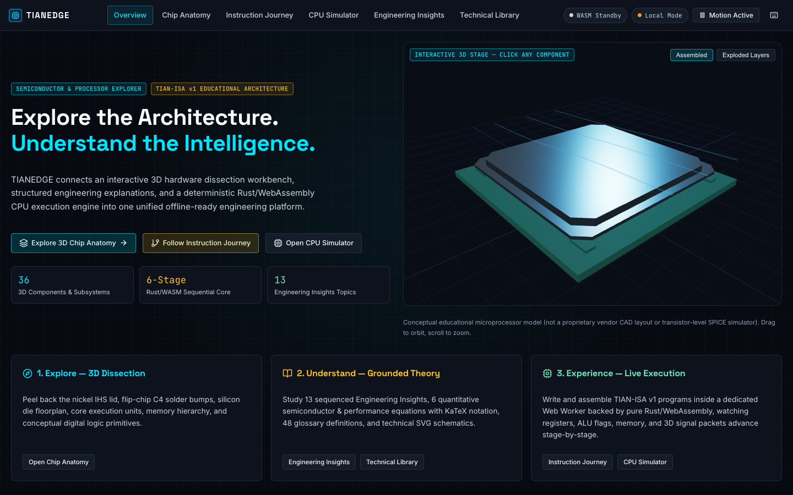

</details>

---

### 02 · Chip Anatomy

The main 3D workbench. On the left is the **component tree** (6 groups, 36 components, with search and show/hide toggles per group and per item). The **3D viewport** sits in the centre, and the **engineering dossier** of the selected component is on the right: definition, function, engineering principles, construction, operation, internal structure, materials, performance metrics, related components and Insights links.

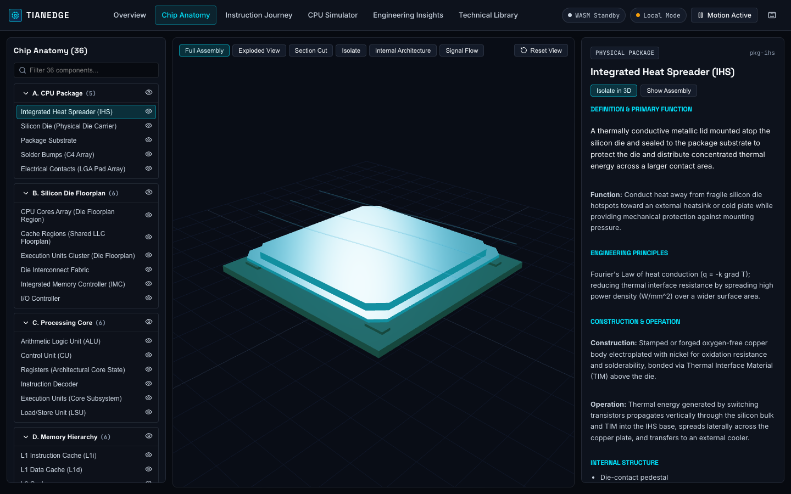
<sub><b>Full Assembly</b>: the closed package with the Integrated Heat Spreader selected (live)</sub>

**Six visualization modes** (the toolbar above the viewport):

| Mode | What you see |
|---|---|
| `Full Assembly` | The closed package: IHS lid, substrate, die and contacts |
| `Exploded View` | Every layer pulled apart vertically so you can see the stack |
| `Section Cut` | A clipping plane slices through the package; a slider moves the cut |
| `Isolate` | Only the selected component stays solid; the package remains as a faint ghost for context |
| `Internal Architecture` | The IHS is lifted and turned translucent to show the die floorplan and core blocks |
| `Signal Flow` | Same view as Internal Architecture, with buses, data paths, control lines and clock distribution highlighted |

<table>
<tr>
<td width="50%">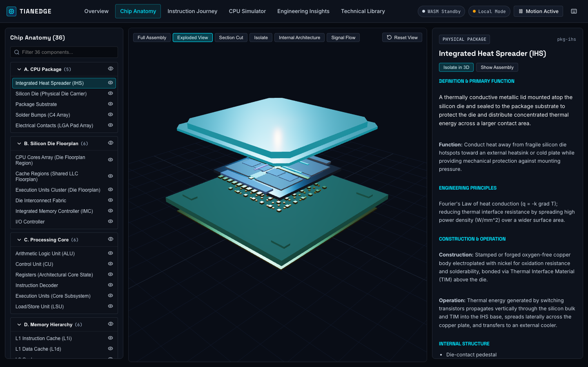<br><sub><b>Exploded View</b>: IHS, die, C4 bumps and substrate separated (live)</sub></td>
<td width="50%">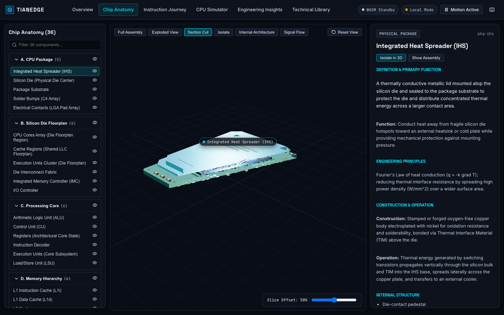<br><sub><b>Section Cut</b>: clipping plane through the package (live)</sub></td>
</tr>
<tr>
<td width="50%">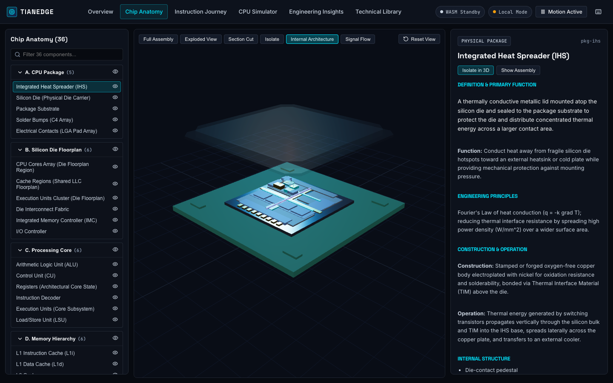<br><sub><b>Internal Architecture</b>: translucent lid lifted over the die floorplan (live)</sub></td>
<td width="50%">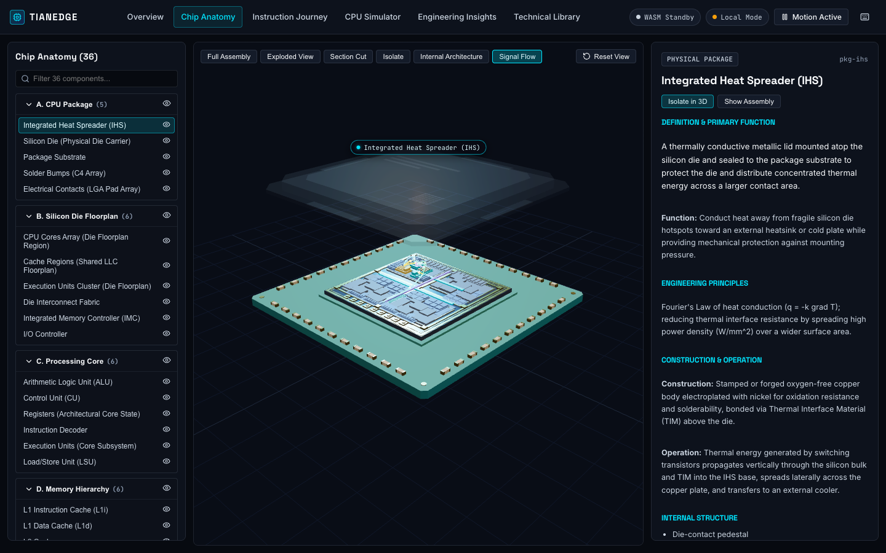<br><sub><b>Signal Flow</b>: on-chip buses and clock network (live)</sub></td>
</tr>
<tr>
<td width="50%">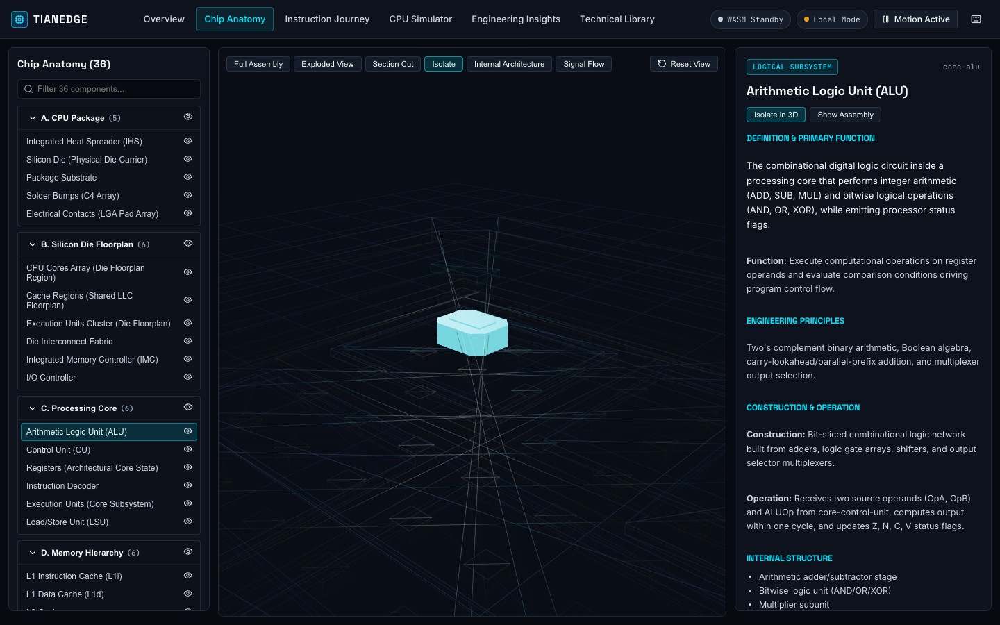<br><sub><b>Isolate</b>: the Arithmetic Logic Unit on its own, with its dossier (live)</sub></td>
<td width="50%">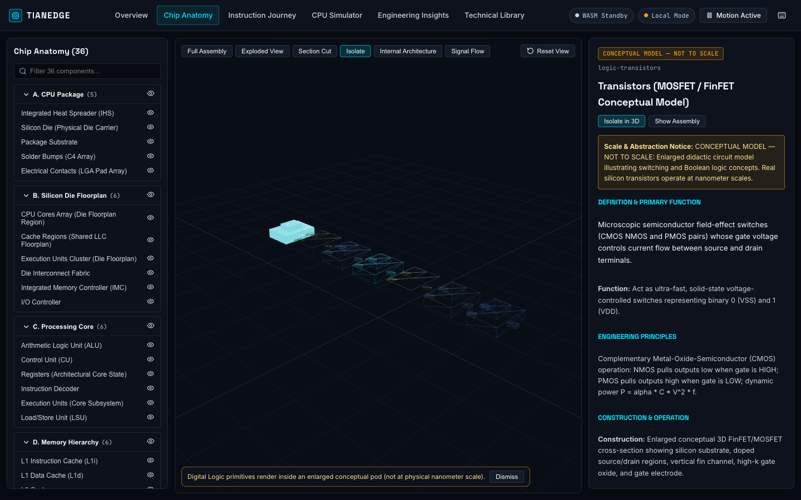<br><sub><b>Digital Logic</b> group: the enlarged, not-to-scale transistor pod with its scale notice (live)</sub></td>
</tr>
</table>

**The 36 components:**

| Group | Components |
|---|---|
| **A. CPU Package** (5) | Integrated Heat Spreader · Silicon Die · Package Substrate · Solder Bumps (C4) · Electrical Contacts (LGA) |
| **B. Silicon Die Floorplan** (6) | CPU Cores Array · Cache Regions (LLC) · Execution Units Cluster · Die Interconnect Fabric · Integrated Memory Controller · I/O Controller |
| **C. Processing Core** (6) | ALU · Control Unit · Registers · Instruction Decoder · Execution Units · Load/Store Unit |
| **D. Memory Hierarchy** (6) | L1 I-Cache · L1 D-Cache · L2 Cache · L3 Cache · Register File · Main Memory Interface |
| **E. Digital Logic** (7) | Transistors (MOSFET/FinFET) · Logic Gates · Flip-Flops · Multiplexers · Adders · Combinational Logic · Sequential Logic |
| **F. Communication** (6) | Internal Buses · Data Paths · Control Signals · Clock Distribution · Interconnect Network · Memory Interface |

**What the 3D model contains** (all generated by [`apps/web/scripts/generate_models.py`](apps/web/scripts/generate_models.py), mesh names `tianedge__<componentId>__<part>`):

| Layer | Modelled detail |
|---|---|
| Package | Nickel IHS with flange, machined top land, laser marking, 2D matrix code and pin-1 mark · substrate with underfill fillet, 44 MLCC decoupling capacitors, fiducials · 16 × 16 C4 bump array · 26 × 26 LGA land grid with a land-side capacitor cavity |
| Die floorplan | Seal ring · four core tiles (core 0 fully detailed, cores 1–3 replicated) · LLC banks split into SRAM sub-arrays · ring bus with ring stops · memory controller with four channel PHYs · I/O controller with 16 SerDes lanes |
| Core 0 | ALU with 8 bit-slices, carry chain and Z/N/C/V flag latches · control unit with microcode ROM · R0–R7 register bank · decoder with AND/OR PLA planes · integer/FP/SIMD pipes · load/store unit with AGU and queues · L1I / L1D / L2 SRAM macros with sense-amp strips · 4 L3 slices |
| Digital logic pods | FinFET (fins, wrap-around gate, source/drain contacts) · AND/OR/XOR gates · master-slave flip-flop · 4:1 multiplexer · 4-bit ripple-carry adder · PLA crosspoint matrix · FSM with feedback loop |

A floating name tag follows the selected component through every mode. In `Isolate`, small blocks get a close-up camera, and the substrate and die stay as faint translucent silhouettes for context.

The selected component and mode are kept in the URL (`/anatomy?component=core-alu&mode=component_isolation`), so any view can be shared as a link. Press `R` to reset the camera.

---

### 03 · Instruction Journey

A guided, step-by-step walk of one instruction through the six stages. It runs on the **same Rust/WASM engine** as the simulator, so the register and memory values shown are computed, not scripted.

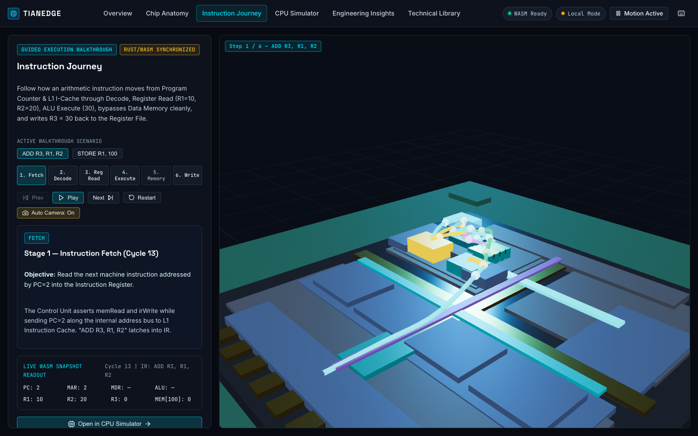
<sub><b>Stage 1: Fetch</b> for <code>ADD R3, R1, R2</code>. The PC drives the instruction address bus into the L1 I-Cache (live)</sub>

| Control | Options |
|---|---|
| Walkthrough scenario | `ADD R3, R1, R2` (an ALU instruction that skips memory) · `STORE R1, 100` (a memory write) |
| Stage tabs | `1. Fetch` · `2. Decode` · `3. Reg Read` · `4. Execute` · `5. Memory` · `6. Write` |
| Transport | `Prev` · `Play` / `Pause` · `Next` · `Restart` |
| `Auto Camera` | On: the camera follows the active stage. Off: free orbit. |
| Live WASM snapshot | PC, MAR, MDR, ALU result, R1–R3 and `MEM[100]` for the current stage |
| `Open in CPU Simulator` | Hands the same program over to the simulator |

<table>
<tr>
<td width="50%">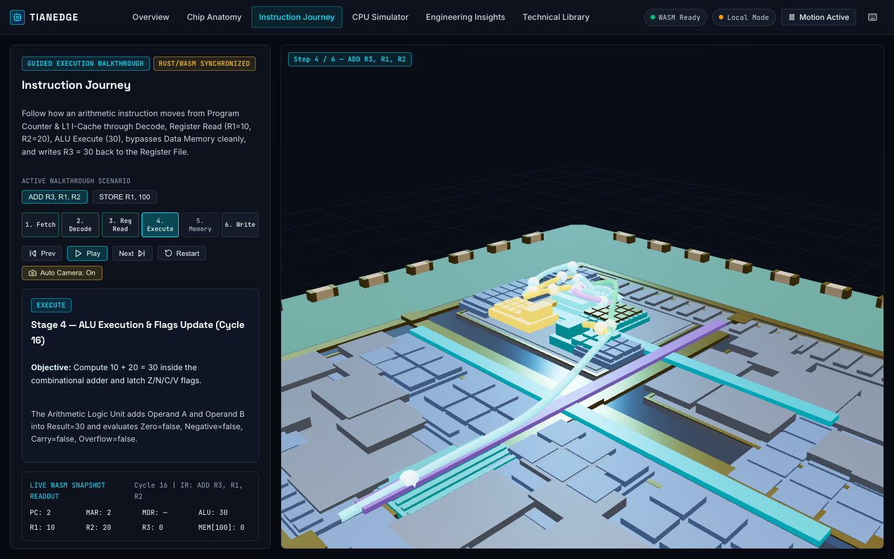<br><sub><b>Stage 4: Execute</b>: the ALU computes 10 + 20 = 30 (live)</sub></td>
<td width="50%">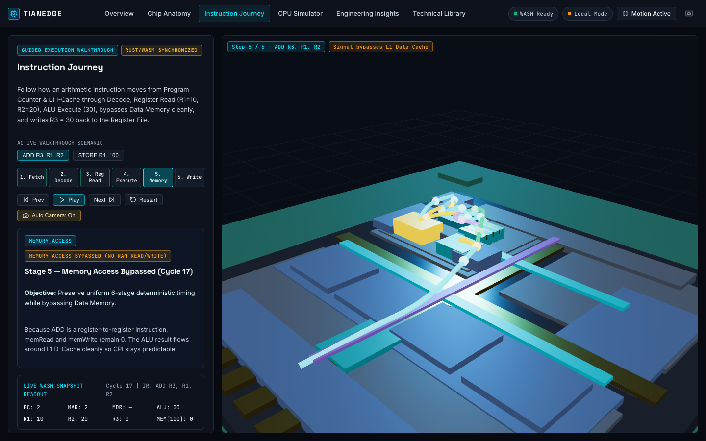<br><sub><b>Stage 5: Memory</b> is <b>bypassed</b> for an ALU instruction, and the UI says so (live)</sub></td>
</tr>
</table>

---

### 04 · CPU Simulator

A three-column workbench. On the left: the program and its controls. In the centre: the 6-stage pipeline strip, the 3D die with live signal flow, and the IR / ALU / control-signal readout. On the right: cycle and control registers, flags, `R0`–`R7` and the 256-word data memory.

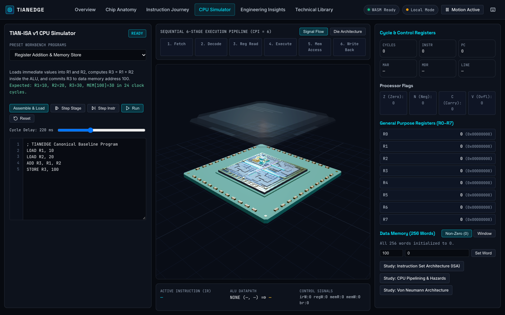
<sub>Ready state with the canonical baseline program loaded in the editor (live)</sub>

| Group | Options |
|---|---|
| **Preset programs** | Register Addition & Memory Store (24 cycles) · Memory Store & Read-Back · Iterative Sum Loop (1 to 5) · ALU Flags & Signed Underflow · Pointer / Indirect Memory Access |
| **Transport** | `Assemble & Load` · `Step Stage` · `Step Instr` · `Run` / `Pause` · `Reset` |
| **Cycle delay** | Slider from *Fast (Batch)* up to a slow, readable step speed |
| **Editor** | Free-form TIAN-ISA v1 source with labels and `;` comments; parse errors are reported by line |
| **3D view** | `Signal Flow` or `Die Architecture` |
| **Data memory** | `Non-Zero` / `Window` views, plus a `Set Word` editor to poke values before running |
| **Study links** | Each preset links to the Engineering Insights topics behind it |

<table>
<tr>
<td width="50%">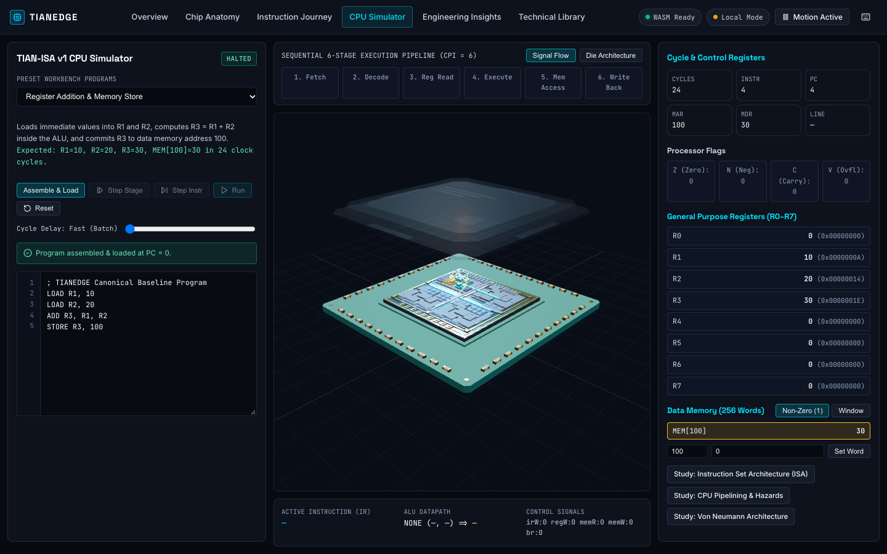<br><sub>Baseline program <b>HALTED</b> after 24 cycles / 4 instructions: R1=10, R2=20, R3=30, MEM[100]=30 (live)</sub></td>
<td width="50%">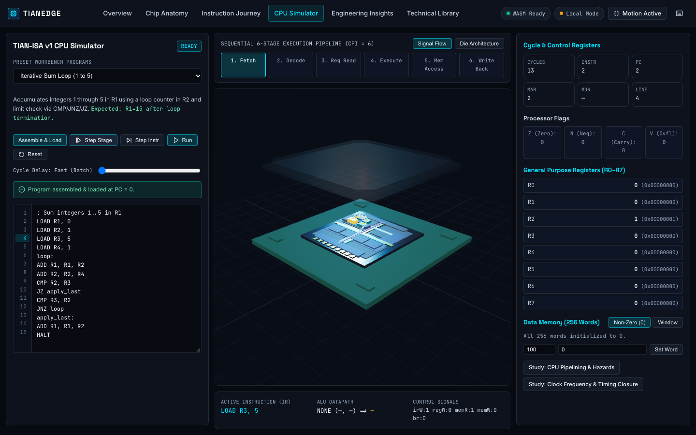<br><sub><b>Iterative Sum Loop</b> stepped instruction by instruction (live)</sub></td>
</tr>
</table>

Safety rails: memory addresses are bounds-checked (0–255), and a **10,000-cycle watchdog** stops runaway loops with `CYCLE_LIMIT_REACHED`, so a bad program cannot freeze the tab.

---

### 05 · Engineering Insights

Thirteen topics in a fixed learning order. Each one has a learning objective, technical definition, engineering explanation, a *general principle vs. proprietary vendors* note, an SVG schematic, formulas, and links back to the related 3D components.

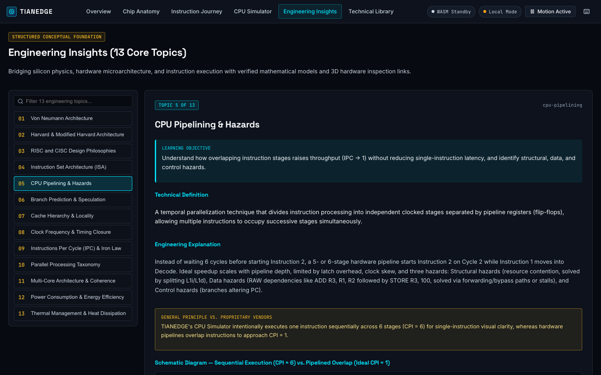
<sub>Topic 05: <b>CPU Pipelining & Hazards</b> (live)</sub>

| # | Topic | # | Topic |
|---|---|---|---|
| 01 | Von Neumann Architecture | 08 | Clock Frequency & Timing Closure |
| 02 | Harvard & Modified Harvard Architecture | 09 | Instructions Per Cycle (IPC) & Iron Law |
| 03 | RISC and CISC Design Philosophies | 10 | Parallel Processing Taxonomy |
| 04 | Instruction Set Architecture (ISA) | 11 | Multi-Core Architecture & Coherence |
| 05 | CPU Pipelining & Hazards | 12 | Power Consumption & Energy Efficiency |
| 06 | Branch Prediction & Speculation | 13 | Thermal Management & Heat Dissipation |
| 07 | Cache Hierarchy & Locality | | |

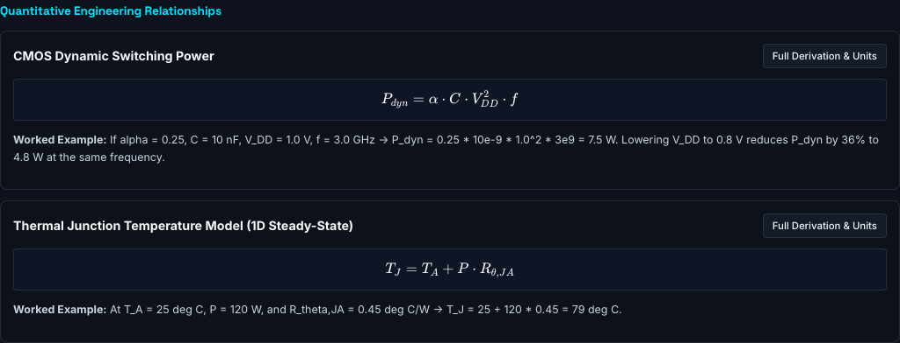
<sub>Formulas are typeset with KaTeX, with every variable defined (live)</sub>

---

### 06 · Technical Library

An offline knowledge base with local search across all content types.

| Module | Contents |
|---|---|
| **Encyclopedia** (36) | One card per chip component, each linking back to the 3D view |
| **Glossary** (48) | Terms from ALU and AMAT to Amdahl's Law, BEOL, C4 bumps and CMOS |
| **Fundamentals** (5) | Primers on the basics |
| **References** (3) | Reference matrices |
| **Diagrams** (6) | 6-stage datapath · Modified Harvard memory map · package cross-section · CMOS inverter · H-tree clock network · sequential vs. pipelined Gantt chart |
| **Formulas** (6) | Iron Law · CMOS dynamic power · AMAT · Amdahl's Law · junction temperature · clock timing constraint |
| **Learning Paths** (4) | CPU Foundations · Inside an Instruction · Memory Hierarchy & Performance · Packaging, Power & Thermal |
| **Citations & Assets** | Sources and asset provenance |

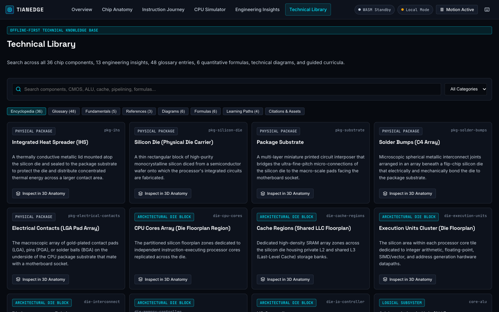

<table>
<tr>
<td width="50%">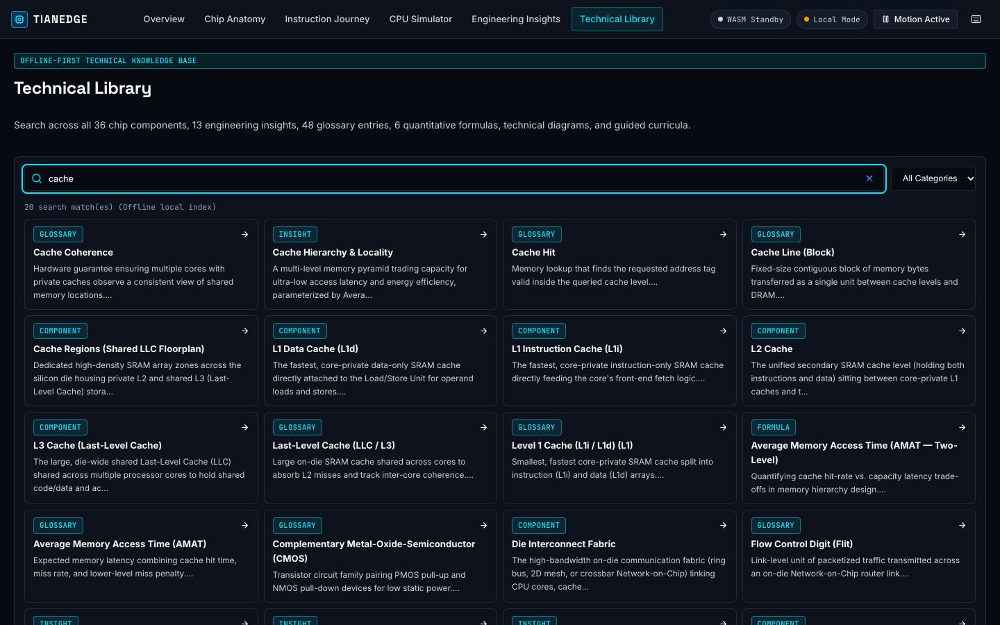<br><sub>Hybrid local search for <code>cache</code> (live)</sub></td>
<td width="50%">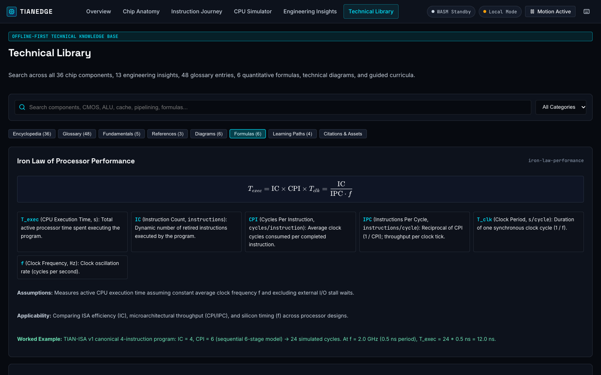<br><sub><b>Formulas</b> module with KaTeX (live)</sub></td>
</tr>
<tr>
<td width="50%">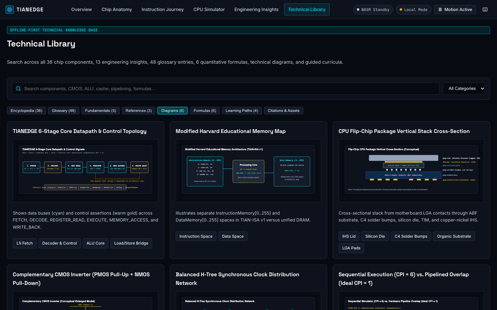<br><sub><b>Diagrams</b>: technical SVG schematics (live)</sub></td>
<td width="50%">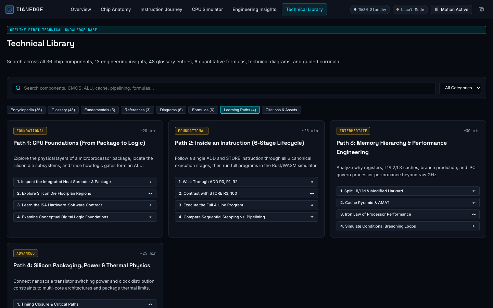<br><sub><b>Learning Paths</b>: four guided curricula (live)</sub></td>
</tr>
</table>

---

### Mobile layout

The layout is responsive down to 390 px. Below 1100 px the navigation moves into a hamburger drawer, which also shows the status pills. On stacked layouts the 3D stage comes first and the component tree becomes a compact scrolling list.

<table>
<tr>
<td width="25%">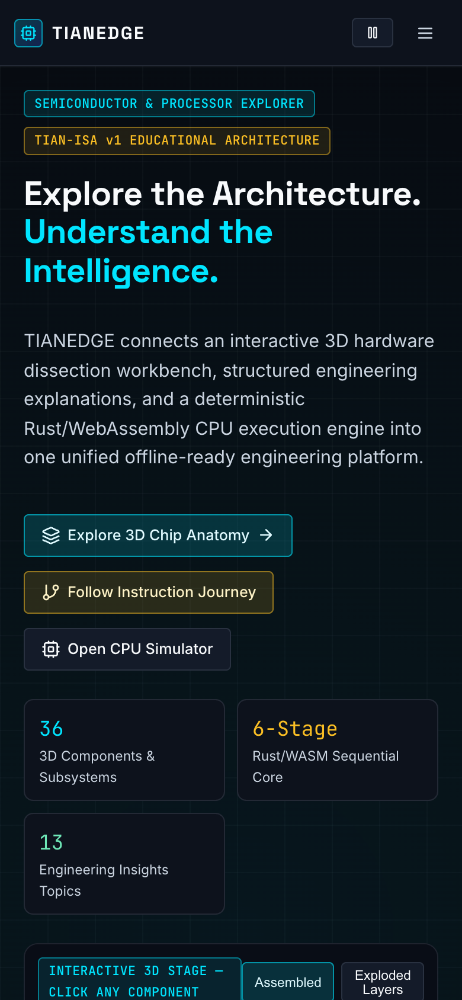<br><sub>Overview</sub></td>
<td width="25%">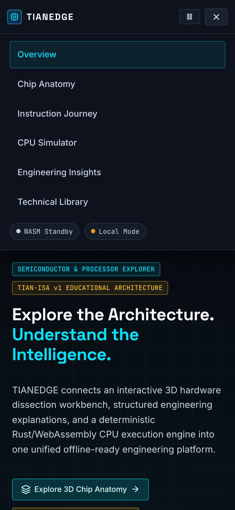<br><sub>Navigation drawer</sub></td>
<td width="25%">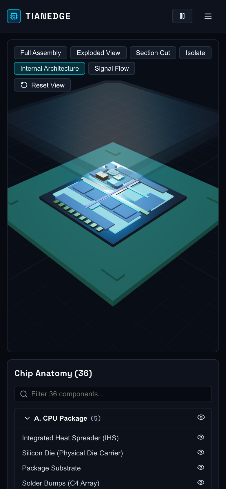<br><sub>Chip Anatomy</sub></td>
<td width="25%">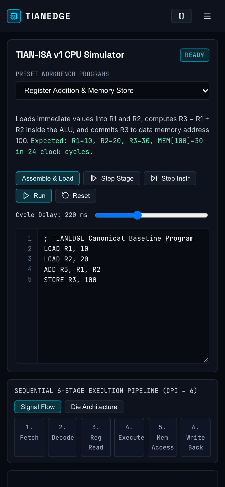<br><sub>CPU Simulator</sub></td>
</tr>
</table>

### Keyboard shortcuts

| Key | Action |
|---|---|
| `?` | Open the shortcut reference |
| `Esc` | Close the dialog |
| `R` | Reset the 3D camera (Chip Anatomy) |
| `Space` | Run / pause the CPU Simulator (when the editor is not focused) |
| `F10` / `Shift+→` | Step one full instruction |
| `Shift+↓` | Step one pipeline stage |

---

## TIAN-ISA v1 at a glance

A small 32-bit teaching ISA defined in [SIMULATION_SPEC.md](SIMULATION_SPEC.md). It uses a Modified Harvard layout with separate instruction memory and data memory, so a `STORE` can never overwrite the program.

| State | Description |
|---|---|
| `R0`–`R7` | 8 × 32-bit signed general-purpose registers |
| `PC`, `IR`, `MAR`, `MDR` | Program counter, instruction register, memory address / data registers |
| `FLAGS` | `Z` zero · `N` negative · `C` unsigned carry/borrow · `V` signed overflow |
| Memory | 256 instruction slots + 256 data words, bounds-checked |

| Class | Instructions |
|---|---|
| Data movement | `LOAD Rd, imm` · `LOAD Rd, [addr]` / `LOADM` · `STORE Rs, addr` · `MOV Rd, Rs` |
| Arithmetic / logic | `ADD` · `SUB` · `MUL` · `AND` · `OR` · `XOR` (all `Rd, Ra, Rb`, updating flags) · `CMP Ra, Rb` |
| Control flow | `JMP` · `JZ` (`BEQ`) · `JNZ` (`BNE`) · `NOP` · `HALT` |

Every instruction passes through the same six stages (CPI = 6, sequential, no pipelining). For each stage the engine records whether it is **active** or **bypassed**, which component IDs it touches and which data-path edges carry the signal. The 3D scene and the Journey read those records directly.

```asm
; Canonical baseline: 4 instructions, 24 cycles
LOAD  R1, 10
LOAD  R2, 20
ADD   R3, R1, R2     ; R3 = 30, flags updated
STORE R3, 100        ; MEM[100] = 30
```

---

## How it works

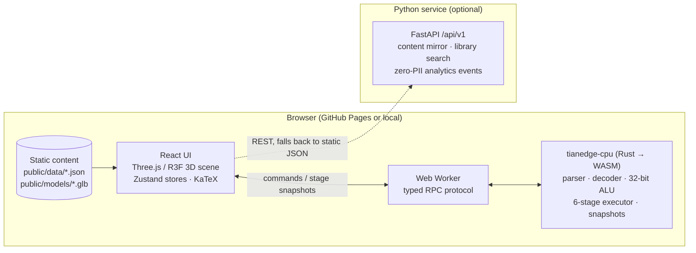

**One instruction, six stages:**

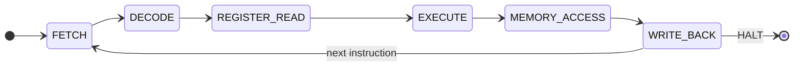

Key design points:

1. **One source of truth for CPU state.** Registers, memory, PC, flags and cycle count live only inside the Rust/WASM engine. The UI stores are read-only mirrors of the snapshots it emits. The Journey and the Simulator share the same engine.
2. **Off the main thread.** The engine runs in a dedicated Web Worker, so long runs never block the WebGL render loop or the UI.
3. **Shared component IDs.** The 36 IDs in `components.json` (for example `core-alu`, `mem-l1-dcache`) are used by the engine, the GLB mesh names (`tianedge__<id>__*`), the dossiers, the Insights links and the Library cards.
4. **Graceful degradation.** Without WebGL, a 2D schematic fallback takes over. A missing GLB is replaced by a procedural mesh. Without the API, content comes from static JSON. Reduced motion stops the idle rotation and pulsing.

Deep dives: [ARCHITECTURE.md](ARCHITECTURE.md), [SIMULATION_SPEC.md](SIMULATION_SPEC.md), [CHIP_ANATOMY_SPEC.md](CHIP_ANATOMY_SPEC.md).

---

## Tech stack

| Layer | Technologies |
|---|---|
| **Frontend** | TypeScript (strict), React 18, Vite, React Router, Zustand, lucide-react, KaTeX |
| **3D** | Three.js, `@react-three/fiber`, `@react-three/drei` (orbit controls, procedural Lightformer environment, HTML labels), binary glTF 2.0 assets generated by [`generate_models.py`](apps/web/scripts/generate_models.py) |
| **Simulation core** | Rust, `wasm-bindgen`, `serde`, `wasm-pack`, Web Workers |
| **Supporting API** | Python 3.12, FastAPI, Pydantic v2, Uvicorn, Docker |
| **Testing** | `cargo test`, pytest, Vitest + Testing Library, Playwright (WebGL) + `axe-core` |
| **Delivery** | GitHub Actions → GitHub Pages (static frontend + WASM) |

---

## Repository structure

```text
TianEdge/
├── .github/workflows/
│   ├── ci.yml                     # Rust tests + wasm32 check · pytest · WASM build, typecheck, lint, Vitest, build
│   └── deploy.yml                 # Builds with VITE_BASE_PATH=/TianEdge/ and deploys to GitHub Pages
├── apps/web/                      # React + R3F frontend
│   ├── src/pages/                 # Overview · ChipAnatomy · InstructionJourney · CpuSimulator · EngineeringInsights · TechnicalLibrary
│   ├── src/scene/                 # R3F canvas, camera rig, GLB loader, data paths, animation math
│   ├── src/workers/               # cpu-worker.ts + typed RPC client/protocol
│   ├── src/stores/                # Zustand stores (app, anatomy, journey, simulator)
│   ├── src/content/               # Content service, validators, local search
│   ├── src/wasm/                  # wasm-pack output (generated)
│   ├── public/data/               # 36 components, 13 insights, glossary, formulas, diagrams, paths…
│   ├── public/models/             # cpu_package_v1.glb · cpu_die_core_v1.glb · logic_foundation_v1.glb
│   ├── e2e/                       # Playwright E2E + WebGL metrics + axe-core
│   └── screenshots/               # Playwright README screenshot capture
├── crates/tianedge-cpu/           # Rust → WASM TIAN-ISA v1 engine
├── services/api/                  # Optional FastAPI service + Dockerfile
├── docs/screenshots/              # Images used in this README
└── *.md                           # PRD, architecture, specs, data model, API contract, design, test plan
```

---

## Getting started

### Prerequisites

- **Node.js ≥ 20** and npm
- **Rust** stable + `wasm-pack` (`rustup target add wasm32-unknown-unknown`)
- **Python ≥ 3.12** (only for the optional API)

### 1 · Build the WASM engine

```bash
npm --prefix apps/web install
```

```bash
npm --prefix apps/web run build:wasm
```

### 2 · Run the web app

```bash
npm --prefix apps/web run dev
```

Open http://localhost:5173. The app is fully functional without the API.

### 3 · Run the API (optional)

```bash
cd services/api && python3 -m venv .venv && source .venv/bin/activate && pip install -e ".[dev]" && uvicorn tianedge_api.main:app --reload --port 8000
```

Or with Docker:

```bash
docker build -t tianedge-api services/api && docker run -p 8000:8000 tianedge-api
```

Then start the web app with `VITE_API_BASE_URL=http://127.0.0.1:8000`.

### Environment variables

| Variable | Where | Purpose |
|---|---|---|
| `VITE_BASE_PATH` | web build | Public base path (`/TianEdge/` for GitHub Pages, `/` locally) |
| `VITE_API_BASE_URL` | web build | Optional FastAPI base URL. If empty, the app uses static JSON only. |
| `ALLOWED_ORIGINS` | API | CORS origins (default: `https://orls967.github.io`, `http://localhost:5173`) |
| `ANALYTICS_ENABLED` | API | Accept anonymous `/api/v1/analytics/events` |

---

## Testing & CI/CD

```bash
cargo test --manifest-path crates/tianedge-cpu/Cargo.toml
```

```bash
services/api/.venv/bin/pytest services/api
```

```bash
npm --prefix apps/web run typecheck && npm --prefix apps/web run lint && npm --prefix apps/web run test
```

```bash
npm --prefix apps/web run build && npm --prefix apps/web run test:e2e
```

| Suite | Coverage |
|---|---|
| **Rust** (9 tests) | `tc_cpu_01`–`tc_cpu_08`: reset/load, the canonical program at cycles 16 and 24, SUB/CMP flags and conditional branches, the 1..5 sum loop, indirect addressing and memory-bounds faults, parse errors and invalid jump targets, the 10,000-cycle watchdog, clean reset; plus a WASM JSON contract round-trip |
| **Python** (5 tests) | Health and dataset counts, component filtering and lookup, insights and library endpoints, and rejection of analytics payloads with extra (PII) fields |
| **Web** (18 tests) | App shell and routing for all 6 routes, content-bundle integrity (36 components, 13 insights, cross-links), local search, worker protocol, scene math |
| **E2E** (4 tests) | All 6 routes in real Chromium + WebGL with draw-call and triangle budgets · WASM parity and the Journey → Simulator handoff · no horizontal overflow at 1024×768 and 390×844 · `axe-core`: 0 critical/serious WCAG violations |

**GitHub Actions:** [`ci.yml`](.github/workflows/ci.yml) runs on every push and PR to `main`. [`deploy.yml`](.github/workflows/deploy.yml) builds with `VITE_BASE_PATH=/TianEdge/`, adds a `404.html` SPA fallback so deep links such as `/TianEdge/anatomy` work, and publishes to GitHub Pages.

### Regenerating screenshots

```bash
cd apps/web && SHOTS_BASE_URL=https://orls967.github.io/TianEdge/ npm run screenshots
```

Use `SHOTS_BASE_URL=http://127.0.0.1:4173/` against a local `npm run build && npm run preview`. Images are written to `docs/screenshots/`.

---

## Measured footprint

| Metric | Result |
|---|---|
| WASM engine (`tianedge_cpu_bg.wasm`) | `75 kB` |
| GLB assets | 3 files, `1.4 MB` total, `24,027` triangles in 41 named nodes, 36/36 component coverage ([`ASSET_MANIFEST.json`](apps/web/public/models/ASSET_MANIFEST.json)) |
| `/anatomy` scene (Playwright WebGL probe) | `23` draw calls, `20,383` rendered triangles, `0` fallback assets (budget: 120 / 150,000) |
| Baseline program | 4 instructions → 24 cycles, deterministic |

---

## Documentation index

| Document | Covers |
|---|---|
| [PRD.md](PRD.md) | Product requirements, scope, acceptance criteria |
| [ARCHITECTURE.md](ARCHITECTURE.md) | 7-layer architecture, state ownership, worker/WASM and offline protocols |
| [DESIGN.md](DESIGN.md) | "Semiconductor Lab + Technology Museum" visual direction, tokens, layouts, accessibility |
| [CHIP_ANATOMY_SPEC.md](CHIP_ANATOMY_SPEC.md) | 6-group / 36-component taxonomy with 15 engineering fields each |
| [INSTRUCTION_JOURNEY_SPEC.md](INSTRUCTION_JOURNEY_SPEC.md) | Stage-by-stage walkthrough synced with the camera and signal pulses |
| [SIMULATION_SPEC.md](SIMULATION_SPEC.md) | TIAN-ISA v1, the 24-cycle baseline trace, Rust/WASM API, error guards |
| [DATA_MODEL.md](DATA_MODEL.md) | TypeScript, Rust `serde`, JSON and API schemas |
| [API_CONTRACT.md](API_CONTRACT.md) | `/api/v1/*` endpoints, validation, offline degradation |
| [ASSET_GUIDELINES.md](ASSET_GUIDELINES.md) | GLB/procedural strategy, mesh naming, PBR and draw-call budgets |
| [ENGINEERING_CONTENT_SPEC.md](ENGINEERING_CONTENT_SPEC.md) | The 13 Insights topics and 7 Library modules |
| [ANIMATION_SPEC.md](ANIMATION_SPEC.md) | Idle and guided animations, reduced motion |
| [TEST_PLAN.md](TEST_PLAN.md) | Test suites and acceptance verification |
| [DEPLOYMENT.md](DEPLOYMENT.md) | GitHub Pages + WASM and containerized API deployment |
| [flow.md](flow.md) · [constraints.md](constraints.md) | Roadmap and engineering invariants |
| [IMPLEMENTATION_PROGRESS.md](IMPLEMENTATION_PROGRESS.md) | Milestone-by-milestone delivery log |

---

## Known limitations

1. **Stylized 3D, not CAD.** The GLB models are procedurally generated (about 24 k triangles) and depict *generic* structures: a 16 × 16 C4 bump array, a 26 × 26 LGA land grid, MLCC capacitors, SRAM sub-arrays, an 8-slice ALU and so on. Proportions are illustrative and not taken from any real product's floorplan.
2. **Sequential core only.** The engine runs one instruction at a time through six stages (CPI = 6). Pipelining, hazards and branch prediction are explained in Insights but not simulated.
3. **No caches in the simulator.** L1/L2/L3 appear in the 3D model and in the content, but simulated memory accesses go straight to the 256-word data memory.
4. **The hosted demo has no backend.** GitHub Pages serves static files, so `API Synced` mode needs a locally run (or separately deployed) FastAPI service. No feature depends on it.
5. **Desktop-first.** Mobile works, but the three-panel workbenches are easiest to use at 1280 px and wider.

---

<div align="center">
<sub>TIANEDGE: an educational semiconductor and microprocessor explorer. Conceptual model, not to scale.</sub>
</div>
