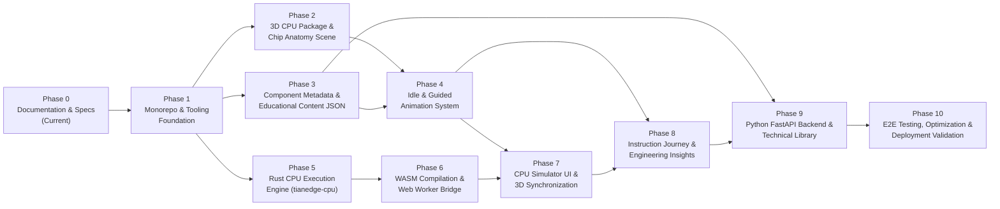

# Implementation Roadmap & Phase Dependencies — TIANEDGE

**Document ID:** `TIANEDGE-FLOW-001`  
**Product Name:** TIANEDGE — Semiconductor & Microprocessor Exploration Platform  
**Purpose:** Sequenced, dependency-driven implementation blueprint for future coding phases  

---

## 1. Roadmap Overview & Dependency Graph

TIANEDGE must be constructed strictly in dependency order so that canonical data schemas, 3D component IDs, and the deterministic Rust/WASM engine lock into place before UI integration and cross-layer animation coupling.

---

## 2. Phase-by-Phase Specification

### Phase 0 — Documentation & Technical Foundation *(Current Milestone)*

- **Objectives:** Establish a complete, cross-audited, implementation-ready Markdown specification suite.
- **Tasks:** Author all 18 required specification, audit, and tracking documents; initialize repository hygiene (`.gitignore`); commit and push documentation milestones.
- **Dependencies:** None.
- **Deliverables:** Complete Markdown documentation package (`PRD.md` through `DOCUMENTATION_AUDIT.md`).
- **Acceptance Criteria:** Zero unresolved contradictions in `DOCUMENTATION_AUDIT.md`; all 6 pages, 36 components, `TIAN-ISA v1`, and API contracts fully defined.
- **Tests:** Cross-document consistency checklist and Markdown link validation.
- **Completion Condition:** `DOCUMENTATION_AUDIT.md` declares documentation readiness `READY FOR PHASE 1`.

---

### Phase 1 — Repository & Application Foundation

- **Objectives:** Scaffold the TypeScript/React/Vite frontend, Rust crate workspace, Python FastAPI project, shared static data workspace, and unified linting/CI scripts.
- **Tasks:**
  - Create `apps/web/` (React + TypeScript strict + Vite + Tailwind/CSS tokens per `DESIGN.md` + R3F dependencies).
  - Create `crates/tianedge-cpu/` (`Cargo.toml` with `wasm-bindgen`, `serde`, `serde_json`).
  - Create `services/api/` (`pyproject.toml`, FastAPI, Pydantic v2, pytest).
  - Implement base navigation shell covering all 6 routes (`/`, `/anatomy`, `/journey`, `/simulator`, `/insights`, `/library`) with placeholder view containers.
  - Configure ESLint, TypeScript `tsc --noEmit`, `cargo check`, `pytest`, and GitHub Actions CI skeleton.
- **Dependencies:** Phase 0 complete.
- **Deliverables:** Buildable monorepo skeleton across TS, Rust, and Python with dark graphite Laboratory + Museum layout shell.
- **Acceptance Criteria:** `npm run build`, `cargo test`, and `pytest` execute cleanly on skeleton targets; routing switches between all 6 pages without errors.
- **Tests:** Smoke route navigation test, TypeScript typecheck, empty Rust crate unit test, `/api/v1/health` skeleton test.
- **Completion Condition:** Clean CI pass on scaffolded monorepo.

---

### Phase 2 — 3D CPU Package and Chip Anatomy Scene

- **Objectives:** Build the interactive 3D processor model and implement all 6 visualization modes and camera interactions on `/anatomy` and hero `/`.
- **Tasks:**
  - Author/optimize CPU Package GLB assets and procedural floorplan/conceptual meshes per `ASSET_GUIDELINES.md`.
  - Tag every selectable mesh with its canonical `componentId` (all 36 components mapped across 6 groups).
  - Implement Orbit, Zoom, Pan, Reset Camera, Hover Highlight, Click-to-Inspect, Component Tree Visibility Toggle, and Guided Camera Focus.
  - Implement visualization modes: `Full Assembly`, `Exploded View`, `Section Cut`, `Component Isolation`, `Internal Architecture`, and `Signal Flow`.
  - Add WebGL2 loss/unsupported graceful fallback banner + 2D schematic fallback.
- **Dependencies:** Phase 1 complete.
- **Deliverables:** Interactive `<CpuSceneCanvas />` and `/anatomy` workspace.
- **Acceptance Criteria:** All 36 component IDs are selectable/focusable; 6 visualization modes operate at `>= 60 FPS` target with `<= 120` draw calls in full assembly mode.
- **Tests:** Scene component ID registry validation test (every `componentId` resolves to mesh target), mode state transition tests, WebGL budget inspection.
- **Completion Condition:** User can inspect, explode, slice, isolate, and select any of the 36 CPU components smoothly.

---

### Phase 3 — Component Metadata and Educational Content Bundle

- **Objectives:** Populate structured canonical JSON content for all 36 `ChipComponent` records, 13 `EngineeringInsightTopic` records, and `TechnicalLibrary` datasets matching `DATA_MODEL.md`.
- **Tasks:**
  - Author `content/components.json` covering all 36 components with all required structured fields and source citations.
  - Build TypeScript content validation loader and wire the `Chip Anatomy` inspection drawer to display full metadata when a 3D mesh or tree node is selected.
  - Add `"Inspect in 3D"` / `"Related Components"` clickable relationship chips that navigate focus across connected components.
- **Dependencies:** Phase 1 complete (runs in parallel with Phase 2).
- **Deliverables:** Validated static JSON bundle (`apps/web/public/data/`) and fully populated `Chip Anatomy` Inspector Panel.
- **Acceptance Criteria:** 100% of 36 components return complete non-empty fields; selecting any mesh updates the panel in `< 50 ms`.
- **Tests:** JSON schema validation suite checking all 36 IDs, required fields, non-broken cross-links, and valid citation arrays.
- **Completion Condition:** Complete bidirectional sync between 3D selection and structured engineering documentation.

---

### Phase 4 — Idle and Guided Animation System

- **Objectives:** Implement restrained idle animations and state-driven guided animations per `ANIMATION_SPEC.md`.
- **Tasks:**
  - Implement Idle Animation controller (slow hero rotation, subtle core glow oscillation, cooling airflow particles/ribbons, gentle ambient signal pulse) with auto-pause on pointer drag, tab blur, and `prefers-reduced-motion`.
  - Implement Guided Animation controller (smooth damped camera focus interpolation, active component highlight halos, animated directional signal packets along `comm-data-paths` edges).
  - Connect `Chip Anatomy` relationship tracing to guided pulse animations.
- **Dependencies:** Phase 2 and Phase 3 complete.
- **Deliverables:** `AnimationOrchestrator` + `SignalFlowOverlay` + reduced-motion accessibility toggle.
- **Acceptance Criteria:** Zero frame-rate regression during idle mode; reduced-motion immediately halts camera orbit and pulsing animations; guided pulses accurately traverse source-to-destination component coordinates.
- **Tests:** Animation state machine tests, reduced-motion media-query / toggle unit tests, memory leak check on unmounting scene.
- **Completion Condition:** Idle and guided animations behave reliably and consistently with application state.

---

### Phase 5 — CPU Execution Engine in Rust (`tianedge-cpu`)

- **Objectives:** Implement the deterministic `TIAN-ISA v1` CPU simulation core in pure Rust with complete unit test coverage.
- **Tasks:**
  - Implement lexer, parser, label resolver, and structured `ParseError` diagnostics for `TIAN-ISA v1` (`LOAD` immediate & memory `[addr]` / `LOADM`, `STORE`, `MOV`, `ADD`, `SUB`, `MUL`, `AND`, `OR`, `XOR`, `CMP`, `JMP`, `JZ`, `JNZ`, `NOP`, `HALT`).
  - Implement `CpuState` (`R0..R7`, `PC`, `IR`, `MAR`, `MDR`, `FLAGS`, `InstructionMemory[256]`, `DataMemory[256]`, `clock_cycles`, `ExecutionStatus`).
  - Implement deterministic 6-stage stepper (`FETCH`, `DECODE`, `REGISTER_READ`, `EXECUTE`, `MEMORY_ACCESS`, `WRITE_BACK`) emitting `CpuSnapshot` with `active_component_ids` and `active_paths`.
  - Enforce deterministic cycle watchdog / out-of-bounds memory fault protection.
- **Dependencies:** Phase 1 complete.
- **Deliverables:** Pure Rust crate `crates/tianedge-cpu` with `wasm-bindgen` entrypoints.
- **Acceptance Criteria:** Canonical 4-line program (`LOAD R1, 10`, `LOAD R2, 20`, `ADD R3, R1, R2`, `STORE R3, 100`) yields `R1=10`, `R2=20`, `R3=30`, `MEM[100]=30`, `clock_cycles=24` deterministically; all invalid syntax/bounds cases return structured errors without panicking.
- **Tests:** Comprehensive `cargo test` suite covering every opcode, flag (`Z/N/C/V`), branch, memory access, stage transition, and error state.
- **Completion Condition:** 100% passing Rust unit & property tests.

---

### Phase 6 — WASM Compilation and Web Worker Integration

- **Objectives:** Compile `tianedge-cpu` to `wasm32-unknown-unknown`, host it inside `cpu-worker.ts`, and expose a typed async TypeScript RPC client (`CpuWorkerClient`).
- **Tasks:**
  - Add `wasm-pack` / build pipeline scripts emitting `.wasm` + JS glue into `apps/web/src/wasm/`.
  - Implement `cpu-worker.ts` handling `INIT_WASM`, `LOAD_PROGRAM`, `STEP_STAGE`, `STEP_INSTRUCTION`, `RUN`, `PAUSE`, `RESET`.
  - Implement `useSimulatorStore` connecting React UI to `CpuWorkerClient` with bounded high-speed UI snapshot throttling (`<= 30 Hz`) and instant single-step updates.
- **Dependencies:** Phase 5 complete.
- **Deliverables:** Working browser WASM worker pipeline verified offline without Python backend.
- **Acceptance Criteria:** WASM loads in `< 500 ms`; continuous `RUN` of loops does not drop main-thread 3D FPS below target; `PAUSE` and `RESET` respond immediately.
- **Tests:** Vitest/WebWorker integration tests (or mock/headless Chromium WASM worker tests) validating message protocol, error propagation, and state reset.
- **Completion Condition:** Simulator engine executes reliably inside browser Web Worker.

---

### Phase 7 — CPU Simulator Interface & 3D Synchronization

- **Objectives:** Build the `/simulator` workspace combining assembly editor, presets, execution controls, live state telemetry, and synchronized 3D CPU visualization.
- **Tasks:**
  - Build Assembly Program Editor with line numbers, active `PC` line highlight, preset selector (canonical arithmetic, memory read/write, loop/branch example), and inline `ParseError` annotations.
  - Build live Register File (`R0`–`R7` + `PC`, `IR`, `MAR`, `MDR`, `FLAGS`), ALU operation badge, Data Memory inspector (`MEM[0..255]` with modified cell highlight), and 6-Stage Pipeline Indicator (`FETCH`..`WRITE_BACK`).
  - Synchronize `CpuSnapshot.activeComponentIds` and `activePaths` directly into the 3D scene (`Guided Animation` highlighting ALU, Control Unit, Registers, L1 Caches, Buses during each cycle).
- **Dependencies:** Phase 4 and Phase 6 complete.
- **Deliverables:** Complete `/simulator` page executing `TIAN-ISA v1` visually in 3D and numerically in telemetry panels.
- **Acceptance Criteria:** Stepping through `LOAD R1, 10 -> LOAD R2, 20 -> ADD R3, R1, R2 -> STORE R3, 100` visually lights up Instruction Cache -> Decoder -> Register File -> ALU -> Data Memory -> Registers in exact stage sync.
- **Tests:** UI simulator component tests + browser E2E test verifying canonical program execution and stage highlights.
- **Completion Condition:** Primary simulator fully operational offline in the browser.

---

### Phase 8 — Instruction Journey & Engineering Insights

- **Objectives:** Deliver the guided 6-stage `Instruction Journey` (`/journey`) and all 13 `Engineering Insights` (`/insights`) articles linked directly to 3D views and simulator presets.
- **Tasks:**
  - Implement `/journey` with step controls (`Next`, `Prev`, `Play/Pause`, `Reset`, stage picker), synchronized camera presets, data-path animations, and `"Try this in CPU Simulator"` deep link.
  - Author and wire all 13 `Engineering Insights` topics (`Von Neumann`, `Harvard`, `RISC vs CISC`, `ISA`, `Pipelining`, `Branch Prediction`, `Cache Hierarchy`, `Clock Frequency`, `IPC`, `Parallel Processing`, `Multi-core`, `Power Consumption`, `Thermal Management`).
  - Add `"View in Chip Anatomy"` interactive jumps (e.g., Cache Hierarchy article isolates `mem-l1-icache`, `mem-l1-dcache`, `mem-l2-cache`, `mem-l3-cache`).
- **Dependencies:** Phase 4 and Phase 7 complete.
- **Deliverables:** Complete `/journey` and `/insights` routes.
- **Acceptance Criteria:** All 6 Journey stages match `SIMULATION_SPEC.md` semantics; all 13 Insights topics render diagrams, citations, and live 3D component links.
- **Tests:** Content completeness verification + E2E navigation tests between Insights, Chip Anatomy, and Simulator.
- **Completion Condition:** Educational walkthrough and deep-dive architecture modules complete.

---

### Phase 9 — Python FastAPI Backend & Technical Library

- **Objectives:** Implement the optional Python FastAPI backend (`services/api/`) and complete the `/library` Technical Library view with hybrid online/offline behavior.
- **Tasks:**
  - Implement Pydantic v2 schemas matching `DATA_MODEL.md` and FastAPI endpoints per `API_CONTRACT.md` (`/api/v1/health`, `/api/v1/components`, `/api/v1/insights`, `/api/v1/library/search`, `/api/v1/glossary`, `/api/v1/formulas`, `/api/v1/analytics/events`).
  - Build `/library` interface (`Component Encyclopedia`, `Engineering Glossary`, `Semiconductor Fundamentals`, `CPU Architecture References`, `Technical Diagrams`, `Formulas & Equations`, `Learning Paths`) with full-text search & filtering.
  - Wire frontend `ContentService` to query FastAPI when configured/reachable and gracefully fall back to bundled static JSON when offline.
- **Dependencies:** Phase 3 and Phase 8 complete.
- **Deliverables:** Containerized FastAPI backend + complete `/library` section.
- **Acceptance Criteria:** `pytest` passes all API contract, validation, and CORS tests; `/library` search and browsing function identically both with backend live and with backend stopped.
- **Tests:** Pytest FastAPI `TestClient` suite + frontend offline-fallback integration tests.
- **Completion Condition:** Backend services and Technical Library validated end-to-end.

---

### Phase 10 — Integration, Optimization, Testing, and Deployment Validation

- **Objectives:** Execute full system testing per `TEST_PLAN.md`, optimize bundles/3D assets, verify accessibility, and validate deployment workflows per `DEPLOYMENT.md`.
- **Tasks:**
  - Run full unit, integration, 3D interaction, WASM worker, accessibility (`axe`/keyboard), and responsive viewport tests.
  - Verify production static build (`vite build` + `.wasm` MIME/base-path handling) and Dockerized FastAPI build.
  - Verify zero console errors when backend URL is unset/unreachable (simulating GitHub Pages standalone deployment).
  - Run Lighthouse / WebGL performance profiling and optimize any asset bottlenecks.
- **Dependencies:** Phase 9 complete.
- **Deliverables:** Tested, optimized release build and validated deployment configs.
- **Acceptance Criteria:** All test suites green; all 12 Final Product Acceptance Criteria in `PRD.md` satisfied.
- **Tests:** Complete execution of `TEST_PLAN.md` matrix.
- **Completion Condition:** Production release readiness verified.

---

## 3. Cross-Document References

- Product Requirements: [PRD.md](./PRD.md)
- System Architecture: [ARCHITECTURE.md](./ARCHITECTURE.md)
- Constraints & Invariants: [constraints.md](./constraints.md)
- Testing Matrix: [TEST_PLAN.md](./TEST_PLAN.md)
- Deployment Specification: [DEPLOYMENT.md](./DEPLOYMENT.md)
